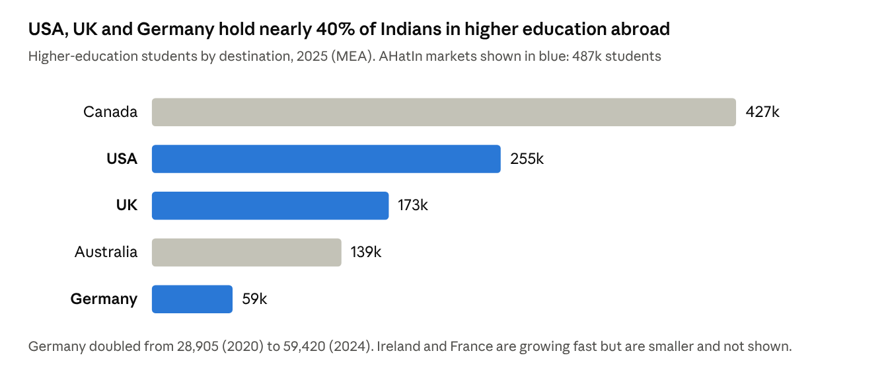
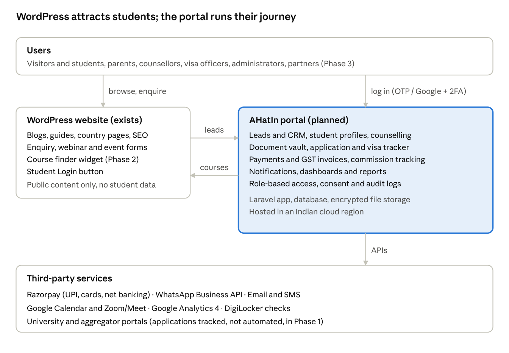
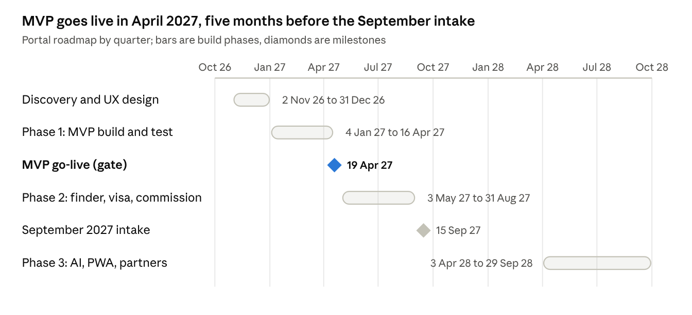
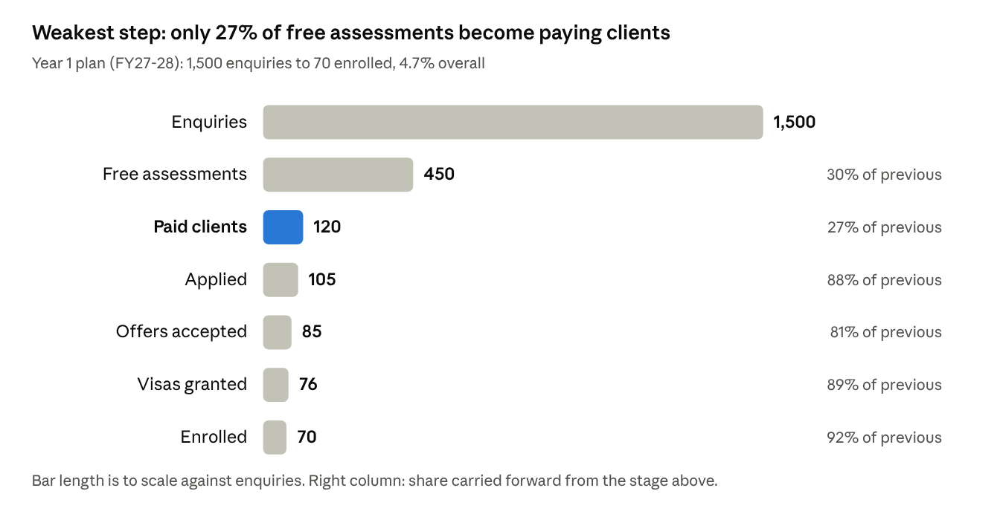

# AHatIn International Educational Consultancy — Business Plan

Oct 20, 2026 · @qubra

## Executive summary

AHatIn can grow from a small counselling practice to about 300 enrolled students and ₹4.1 crore revenue a year by FY29-30. To do it, AHatIn should focus on UK and European master's admissions, earn mostly from university commissions, and run every student's journey through a new portal. The plan needs ₹40 to 45 lakh up front and breaks even in Year 1 at about 62 enrolments.

- **What AHatIn is:** An India-based consultancy guiding students to universities in the UK, USA and Europe. Today it has a WordPress website and a counselling service delivered by people.
- **The opportunity:** 1.25 million Indians studied abroad in 2025, the first fall in four years. Demand is moving away from Canada and the USA towards the UK, Germany, Ireland and France, which suits AHatIn's focus.
- **The model:** Low fees for students going to commission-paying universities (UK, Ireland, European private institutions). Premium fees for US, top-ranked and German public-university applications. Referral income from loans, forex and accommodation.
- **The portal (planned):** One system for students, parents, counsellors and administrators, covering leads, profiles, counselling, documents, applications, visas, payments and reports. It connects to the WordPress site. MVP live in April 2027 for ₹12 to 15 lakh.
- **Financials (base case):** Revenue of ₹0.94 crore, ₹2.2 crore and ₹4.1 crore over FY27-28 to FY29-30. EBITDA margin rising from 11% to 28%.
- **Biggest risks:** Visa policy changes and commission timing. These are managed through destination spread, fee income, a cash reserve and strict compliance.

**Top five actions now:** Secure aggregator access and 10 to 15 direct UK partners. Train counsellors with the British Council. Publish transparent pricing. Commission the portal on fixed-price phases. Launch the September 2027 intake campaign by December 2026.

## 1. Where AHatIn stands today vs what this plan adds

Today AHatIn runs on a WordPress website and a counselling service delivered by people. Everything else in this plan is new. The table below separates the two, so investors, staff and partners can see what already exists and what still has to be built.

| Area | Exists today | Planned (this plan) |
| --- | --- | --- |
| Online presence | WordPress website: brand, service pages, contact/enquiry form | Search-optimised content hub, country/course landing pages, lead capture wired to the portal CRM |
| Lead handling | Enquiries by form, phone, WhatsApp and email, tracked manually (assumed) | Every lead in one CRM with source tracking, automatic assignment and follow-up reminders |
| Counselling | One-to-one advice on country, university and course choice | Structured counselling playbook, profile scoring, shortlisting tool, recorded session notes |
| Applications | Prepared by counsellors using university portals and email | Application tracker per student; status, deadlines and offers visible to student and counsellor |
| Documents | Collected through email/WhatsApp (assumed) | Secure document vault with checklists, version control and verification status |
| Payments | Offline (bank transfer/UPI) (assumed) | Online invoices and payments through Razorpay (UPI, cards, net banking), GST invoices |
| University partners | To be confirmed: direct agreements or sub-agent arrangements | Direct UK agreements plus aggregator access (e.g. ApplyBoard/Adventus/Crizac-type platforms) for the USA and Europe |
| Reporting | Manual | Admin dashboards: funnel, conversion, revenue, counsellor performance |

**Assumptions to confirm:** The working folder holds no website files, so the "exists today" column reflects a typical early-stage consultancy. Please correct anything that is wrong. In particular, confirm team size, current student volume, existing university agreements and the WordPress plugins in use. Each of these changes the cost and revenue figures that follow.

## 2. Business objectives

Over three years, AHatIn aims to grow from a small counselling practice into a trusted, portal-led consultancy placing about 300 students a year. These goals fit one city base, one team and the current market downturn. Year 1 runs April 2027 to March 2028, matching the Indian financial year.

| Objective | Year 1 (FY27-28) | Year 2 (FY28-29) | Year 3 (FY29-30) |
| --- | --- | --- | --- |
| Students enrolled (arrived on campus) | 70 | 160 | 300 |
| Paid counselling clients | 120 | 260 | 450 |
| Enquiry-to-paid conversion | 8% | 10% | 12% |
| Visa success rate | 90%+ | 92%+ | 95%+ |
| Direct university partners | 15 UK + aggregator access | 30 | 50 (UK, Ireland, Germany, France, Netherlands, USA) |
| Revenue (INR) | about ₹0.94 crore | about ₹2.2 crore | about ₹4.1 crore |
| Portal adoption | 100% of new students on portal | Mobile-friendly PWA, parent access | Partner/franchise access |
| Reputation | 50 Google reviews at 4.6+ | 150 reviews | 300 reviews; British Council-trained counsellors |

The revenue figures come from the model in section 10. Every target is reviewed each quarter against the KPIs in sections 6 and 7.

## 3. Market analysis

The Indian outbound market is still large but shrinking for the first time in years, and it is moving away from Canada and the USA towards the UK and Europe. That suits AHatIn's UK, USA and Europe focus, provided it leads with the UK and Europe and treats the USA carefully.

### Market size and direction

- In 2025, 1.25 million Indians were in higher education abroad, down 76,000 on 2024. This is the first fall after three years of growth ([PIE News, MEA data](https://thepienews.com/outbound-indian-university-enrolments-fall-after-three-year-rise/)).
- ICEF puts the 2025 fall at 5.7% and says growth has moved to Germany, France, Ireland and New Zealand ([ICEF Monitor](https://monitor.icef.com/2025/12/the-number-of-indian-students-abroad-fell-in-2025/)).

### Destination outlook for AHatIn

| Destination | Current signal | Implication for AHatIn |
| --- | --- | --- |
| UK | 98,015 sponsored study visas to Indians in the year to June 2025, a 96% approval rate, and 81% for master's courses ([ICEF](https://monitor.icef.com/2025/12/the-number-of-indian-students-abroad-fell-in-2025/)). Graduate Route falls from 2 years to 18 months for applications from 1 January 2027 ([Home Office guidance](https://assets.publishing.service.gov.uk/media/68f62f24f5d433238a14c7df/Graduate+route.pdf)). Universities must use the Agent Quality Framework, and stricter compliance (BCA) thresholds apply ([ICEF](https://monitor.icef.com/2025/05/uk-sets-out-new-immigration-strategy-will-reduce-graduate-route-work-term-to-18-months/)). A £925 per-student levy on English universities starts in August 2028 ([ICEF](https://monitor.icef.com/2025/11/uk-confirms-international-fee-levy-of-925-per-student-starting-august-2028)). | **Core market.** One-year master's degrees, high approval rates and agent-paid commission make the UK the main revenue engine. Universities will prefer compliant, well-trained agents, which favours a careful newcomer. |
| USA | India is the top source country, with 363,019 students in 2024-25, but new international enrolment fell 17% in fall 2025 and graduate enrolment fell 12% ([Careers360, Open Doors 2025](https://news.careers360.com/india-retains-top-position-source-of-international-students-in-us-amid-17-dip-in-college-admissions-report)). F-1 visas to Indians fell 44% in H1 2025 ([ICEF](https://monitor.icef.com/2025/12/the-number-of-indian-students-abroad-fell-in-2025/)). | **Selective.** Few US universities pay commission, so serve this market through fee-based premium counselling for strong profiles. Keep visa expectations honest. |
| Germany | Indian students more than doubled, from 28,905 (2020) to 59,420 (2024). India is Germany's top source market and 60% study engineering ([ICEF](https://monitor.icef.com/2025/12/the-number-of-indian-students-abroad-fell-in-2025/)). | **Growth market.** Public universities charge little or no tuition, so commissions are rare. Earn through service fees: APS, blocked account, uni-assist and German-language support. |
| Ireland | Over 7,000 Indian enrolments in 2023-24, up 50%. India is Ireland's top international market (ICEF). | **Growth market.** English-taught degrees with commission-paying universities. A natural next step after the UK. |
| France | 9,100 Indian students in 2024-25, up 17%. France targets 30,000 by 2030 (ICEF). | **Opportunity.** Business schools pay commission. |

### Target customers

1. **Postgraduate aspirants aged 21 to 28 (primary):** final-year and recent graduates in engineering, computer science, business and data science, aiming for UK, Irish and German master's degrees.
2. **Undergraduate aspirants and their parents:** Class 11 and 12 students in CBSE, ICSE and IB schools, where parents decide and pay.
3. **Working professionals:** MBA and specialised master's candidates with 2 to 6 years' experience who value a premium, time-saving service.
4. **Tier-2 and tier-3 city families:** under-served by the large online platforms, and they value trust and in-person meetings.

### Competition

| Type | Examples | Their strength | AHatIn's angle |
| --- | --- | --- | --- |
| University-network giants | IDP, SI-UK, AECC | Brand, offices, many university partners | Personal, senior-led counselling and a named counsellor throughout |
| VC-funded platforms | [Leverage Edu](https://restofworld.org/2023/3-minutes-with-akshay-chaturvedi-leverage-edu/) (raised $70M), Yocket, Leap Scholar, upGrad Abroad | Digital reach, content, loans | High-touch service plus a portal that matches their transparency |
| Local agents | Many small firms in each city | Low price and proximity | Ethical, transparent advice, British Council-trained staff, a professional portal |

**Market risk to note:** A falling market means fiercer competition for each student. AHatIn wins by converting a higher share of leads, not by chasing volume.

## 4. Services and pricing

AHatIn should sell four clear packages and a few add-ons, each priced openly on the website. Charge students least where universities pay commission (UK, Ireland, private European institutions), and charge most where they don't (USA, German public universities). All prices are **proposed**. They exclude 18% GST and should be checked against local competitors before launch.

| Package | Who it is for | What is included | Proposed fee (INR) |
| --- | --- | --- | --- |
| Free profile assessment | Every enquiry | 30-minute call, profile score, country fit, budget check | Free |
| Essentials: UK and Ireland | Master's and undergraduate applicants to partner universities | Shortlist of up to 5 universities, SOP review, applications, offer comparison, CAS/visa filing, pre-departure briefing | ₹10,000 commitment fee, adjusted against add-ons |
| Europe Plus | Germany, France, Netherlands and other EU destinations | Shortlist, APS and uni-assist guidance, blocked account and insurance setup, visa file, accommodation help | ₹45,000 |
| Premium: USA and top-ranked | USA, Russell Group/Ivy-level targets, MBA | Senior counsellor, up to 8 applications, essay development, scholarship strategy, F-1 interview preparation | ₹75,000 to ₹1,25,000 |
| Undergraduate journey | Class 10 to 12 students and parents | Two-year roadmap, profile building, test planning, UCAS/Common App applications, parent sessions | ₹60,000 to ₹1,50,000 |

**Add-ons:** SOP/LOR writing support (₹8,000 to ₹15,000), visa-only service (₹15,000 to ₹25,000), IELTS/PTE/German-language coaching through a partner (referral or revenue share), scholarship applications, and mock visa interviews.

**Partner referrals (commission to AHatIn, no charge to the student):** education loans (NBFCs and banks), forex and remittance, student accommodation, health insurance, and SIM/banking at destination.

**Service promises:** A named counsellor for every student. A written shortlist rationale that discloses whether each university pays AHatIn commission. Replies within one working day. A refund policy published before payment.

## 5. Revenue model

About 70% of revenue will come from university commissions, 20 to 25% from student service fees, and the rest from partner referrals. Commission is the largest stream but also the slowest and least certain to arrive, so fees and referrals are what keep cash flowing.

| Stream | How it works | Planning assumption | Timing and risk |
| --- | --- | --- | --- |
| University commission | Paid by universities for each enrolled student, usually a share of first-year tuition | ₹1.5 lakh net per commission-eligible enrolment (about £1,300 at ₹115/£), with 65% of enrolments eligible. Reported UK rates are £2,000 to £8,000 per student ([The Boar](https://theboar.org/2025/05/international-students-looking-to-study-in-uk-fed-false-promises-by-recruitment-agents)). Aggregators keep part of the commission. | Paid 1 to 4 months after enrolment or census date. Clawed back if the student withdraws. Exposed to GBP/EUR exchange rates. |
| Student service fees | Package and add-on fees (section 4) | Average ₹18,000 per paying client in Year 1, rising to ₹22,000 by Year 3 as the premium mix grows | Collected up front or in two instalments. 18% GST is added to the invoice. |
| Partner referrals | Loans, forex, accommodation, insurance, test prep | ₹5,000 to ₹7,000 per enrolled student | Paid monthly or quarterly by partners |

**Direct contracts vs aggregators:** Start with an aggregator (sub-agent platforms such as ApplyBoard, Adventus.io or Crizac) to reach 1,000+ institutions without contracts. Then move high-volume universities to direct agreements, which keep the full commission, once AHatIn has a record of 10 to 20 enrolments with each.

**Tax note:** The Finance Act 2026 removed the old rule that taxed intermediary services in India. From 30 March 2026, commission received in foreign currency from overseas universities can qualify as a zero-rated export under a Letter of Undertaking ([Grant Thornton](https://www.grantthornton.in/insights/articles/gst-on-intermediary-services/)). Student fees remain subject to 18% GST. Confirm the treatment with AHatIn's chartered accountant before filing.

## 6. Marketing and sales strategy

The Year 1 plan is to win trust locally and convert leads well. It spends ₹18 lakh to reach about 1,500 enquiries and 70 enrolments, which is roughly ₹25,700 of marketing per enrolled student. The pitch to families is: *honest advice, a named counsellor, and a portal where you can see every step*.

### Channels and Year 1 budget

| Channel | Tactics | Budget (₹ lakh) | KPI |
| --- | --- | --- | --- |
| Paid search and social | Google Search on "study in UK from \[city\]" and similar; Meta lead ads; retargeting of website visitors | 7.0 | Cost per lead under ₹1,200 |
| SEO and content (WordPress) | Country/course guides, cost calculators, visa updates, student success stories | 2.5 | 40% of leads from organic search by Month 12 |
| Video and Instagram | Weekly reels and YouTube explainers, live Q&As with alumni and university representatives | 2.0 | 5,000 followers; 15% of leads |
| Schools and colleges | Seminars at engineering colleges, CBSE/IB schools and coaching centres | 2.0 | 25 seminars a year |
| Events | Own UK/Europe fairs with partner universities; British Council and university visits | 2.0 | 2 events, 300 attendees each |
| Referrals and ambassadors | ₹5,000 reward per enrolled referral; alumni ambassadors | 1.5 | 20% of enrolments from referrals |
| CRM/WhatsApp nurture | Automated drip campaigns, intake reminders, webinar invites | 1.0 | Lead-to-session rate of 30% |
| **Total** |  | **18.0** |  |

### Sales process

1. **Respond within 15 minutes** in working hours (WhatsApp first, then a call). Speed is the biggest single driver of conversion.
2. **Free assessment** with a profile score and an honest view of the student's chances.
3. **Written proposal** setting out the shortlist logic, package, fee and timeline, with a follow-up at 48 hours and again at 7 days.
4. **Sign-up and onboarding on the portal**, with the document checklist issued on day one.
5. **Ask for a review and a referral** after the visa is granted, not after arrival, while gratitude is highest.

The Year 1 conversion funnel is drawn in section 10, alongside the financial assumptions that depend on it.

## 7. Operations plan

AHatIn will run as a small specialist team in one office, working one standard student journey that the portal enforces. The team grows from 6 people in Year 1 to about 16 in Year 3. Hiring follows enrolment volume, at roughly one counsellor for every 35 to 40 active students a year.

### Team plan

| Role | Year 1 | Year 2 | Year 3 | Responsibilities |
| --- | --- | --- | --- | --- |
| Founder / Director | 1 | 1 | 1 | University partnerships, premium counselling, finance, hiring |
| Senior counsellors | 2 | 4 | 6 | Assessments, shortlisting, SOP guidance, student ownership |
| Application and visa officers | 1 | 2 | 3 | Applications, CAS/I-20/visa files, document verification |
| Marketing executive | 1 | 1 | 2 | Ads, content, events, WordPress site |
| Front desk / tele-counsellor | 1 | 1 | 2 | First response, scheduling, lead qualification |
| Operations/portal administrator | 0 | 1 | 1 | Portal administration, reporting, partner payments |
| Branch manager (second city) | 0 | 0 | 1 | Second office in Year 3 |
| **Headcount** | **6** | **10** | **16** |  |

Staff are paid a fixed salary plus an incentive of ₹5,000 to ₹7,500 per enrolled student. The incentive is tied to visa success and student feedback, never to steering students to a particular university.

### Standard student journey (enforced by the portal)

1. Enquiry captured, then assessment booked within 24 hours
2. Assessment and profile score, followed by the proposal
3. Contract and payment, then onboarding and the document checklist
4. Shortlist approved by the student and a parent, with commission disclosure
5. Applications submitted, with deadlines tracked
6. Offers received, compared and accepted, and the deposit paid
7. CAS/I-20/admission letter received, then financial documents checked and the visa filed
8. Visa decided, then pre-departure briefing, accommodation and travel
9. Arrival and enrolment confirmed, commission invoiced, review and referral requested

### Compliance and quality

- **Company set-up:** Private limited company or LLP, GST registration, Shops and Establishments licence, Udyam (MSME) registration, and a trademark for "AHatIn".
- **Agent standards:** UK universities must now follow the Agent Quality Framework, so every counsellor should complete British Council agent training in the first 90 days. Plan for ICEF agency accreditation in Year 2 and AIRC certification (for US institutions) in Year 3.
- **Data protection:** Under India's DPDP Rules 2025, notice, consent and data-fiduciary duties apply from 13 May 2027 ([S.S. Rana](https://ssrana.in/articles/meity-notifies-final-digital-personal-data-protection-rules-2025/)). Build consent capture, data-retention rules and deletion requests into the portal from day one.
- **Document integrity:** Zero tolerance for fake documents. Check marksheets through DigiLocker and university verification portals, and refuse to submit anything that cannot be verified.
- **Quality KPIs:** Visa success rate, offer-to-enrolment rate, average response time, complaint closure within 7 days, and Net Promoter Score (target 60+).

## 8. The AHatIn portal (planned)

The portal is a planned web application that will run every student's journey from enquiry to enrolment in one place. It replaces the current mix of spreadsheets, email and WhatsApp. It is AHatIn's main operational investment and the clearest difference from local competitors.

### Objectives

1. **Transparency for families:** Students and parents can see status, deadlines, documents and payments at any time without phoning the office.
2. **Productivity for counsellors:** Each counsellor can handle 35 to 40 students a year instead of an estimated 20 to 25, through checklists, templates and reminders.
3. **Control for management:** Live funnel, revenue, commission receivables and counsellor performance, with no manual reports.
4. **Compliance by design:** Consent records, audit trails and verified documents to meet DPDP and university agent-quality requirements.
5. **A base for scale:** Supports a second branch, franchise partners and sub-agents without changing the process.

### User roles

| Role | What they do in the portal |
| --- | --- |
| Student (and linked parent) | Profile, documents, shortlist approval, application and visa status, messages, payments, invoices |
| Counsellor | Own caseload, notes, tasks, shortlisting, application tracking, follow-ups, messaging |
| Application/visa officer | Document verification, application submission records, CAS/I-20 and visa tracking |
| Administrator | Users and permissions, university and course catalogue, packages and pricing, commission tracking, reports, settings |
| Partner (later) | Sub-agents, loan and accommodation partners, each seeing only the students they are assigned |

### Key features and release phase

| Module | Key features | Phase |
| --- | --- | --- |
| Lead and CRM | WordPress form capture, source/UTM tracking, auto-assignment, follow-up reminders, lead scoring, duplicate detection | 1 (MVP) |
| Student profile | Academics, test scores, work experience, budget, preferences, profile-completeness score | 1 (MVP) |
| Counselling | Session booking (Google Calendar/Zoom), notes, tasks, counselling history | 1 (MVP) |
| Document vault | Checklists by country and course, uploads, verification status, expiry alerts (passport, test scores), version history | 1 (MVP) |
| Application tracker | One record per application: university, course, intake, status, deadlines, offer conditions, deposit, CAS/I-20 | 1 (MVP) |
| Payments and invoicing | Razorpay links (UPI, cards, net banking), instalments, GST invoices, receipts, refunds | 1 (MVP) |
| Notifications | Email and WhatsApp Business API alerts for status changes, missing documents and deadlines | 1 (MVP) |
| Admin dashboard | Funnel, conversion, revenue, counsellor workload | 1 (MVP) |
| University and course finder | Searchable catalogue with fees, entry requirements, intakes and scholarships, plus shortlisting | 2 |
| Visa and pre-departure | Visa checklists, interview preparation, accommodation, travel and arrival checklist | 2 |
| Commission management | Expected commission per enrolment, invoices to universities and aggregators, receivables ageing, clawbacks | 2 |
| Parent access | Linked parent login with read-only view and payment rights | 2 |
| Reviews and referrals | Post-visa review requests, referral codes and rewards | 2 |
| AI assistance | SOP feedback, profile-to-course matching, document data extraction (human-reviewed) | 3 |
| Mobile app / PWA | Installable app with push notifications | 3 |
| Partner/franchise portal | Sub-agent onboarding, lead sharing, commission splits | 3 |
| Analytics | Cohort conversion, marketing ROI by channel, forecasting | 3 |

## 9. Portal technology, WordPress integration, roadmap and cost

Build the portal as a separate custom web application at a subdomain such as `portal.<ahatin-domain>`. Keep WordPress for marketing content and connect the two through forms, links and a small API. The MVP can go live in **April 2027**, in time for the September 2027 intake. The estimated cost is ₹12 to 15 lakh in Year 1 and about ₹3 lakh a year to run.

### Build vs buy

During discovery, benchmark 2 or 3 off-the-shelf education-agent CRMs. Buy one if it delivers a student-facing portal, Razorpay payments and commission tracking at an acceptable per-user price. Otherwise, build custom. A custom build is the default recommendation: the student experience is AHatIn's differentiator, and owning the data and workflow avoids per-seat fees growing with the team.

### Recommended technology

| Layer | Choice | Why |
| --- | --- | --- |
| Application | Laravel (PHP) with Vue or React front end; responsive, PWA-ready | Large talent pool in India, shares PHP skills with WordPress, fast to build admin screens |
| Database and files | MySQL or PostgreSQL; encrypted object storage for documents | Reliable, low cost; documents encrypted at rest |
| Hosting | AWS or Azure Mumbai region, with daily backups and monitoring | Keeps Indian student data in India; easy to scale |
| Login | OTP by email or phone for students and parents; Google Workspace login and two-factor authentication for staff | Simple for families, secure for staff |
| Payments | Razorpay | UPI, cards and net banking. Standard pricing is about 2% plus GST per transaction, with no setup fee ([Razorpay](https://razorpay.com/blog/razorpay-payment-gateway-pricing-explained/)) |
| Messaging | WhatsApp Business API through an approved provider; transactional email service | Families respond on WhatsApp |
| Scheduling | Google Calendar and Zoom/Meet APIs | Self-service booking |

### Integration with the existing WordPress website

1. **Lead forms to the CRM:** WordPress enquiry, webinar and event forms post to the portal API (by webhook from Gravity Forms, WPForms or Contact Form 7). Each lead arrives with its page, UTM source and campaign.
2. **Login and sign-up:** A "Student Login" button in the WordPress header links to the portal. The free-assessment form creates a portal account straight away.
3. **Course finder widget (Phase 2):** WordPress course and country pages embed live programme data from the portal API, so content and catalogue never drift apart.
4. **Shared brand and analytics:** The same design system, fonts and colours. One Google Analytics 4 property with cross-domain tracking, so marketing ROI is measured all the way to enrolment.
5. **Content stays in WordPress:** Blogs, guides, success stories and SEO pages. The portal holds only private student data.
6. **Hardening WordPress:** Update core and plugins, add a web firewall and backups, remove unused plugins, and add a cookie/consent banner that matches the portal's DPDP notices.

WordPress stays the public front door. Every lead and every login flows into the portal, which is the single record for each student.

### Development roadmap

**Go-live gate (April 2027):** All Phase 1 modules pass user acceptance testing with two counsellors and five students. Security testing raises no high-severity issues. Data from existing students is migrated. Staff are trained. If the gate slips past June 2027, run the September intake on the old process and launch the portal for the January 2028 intake.

### Estimated cost (INR)

| Item | One-time | Annual running | Timing |
| --- | --- | --- | --- |
| Discovery, process mapping, UX/UI design | ₹1.0 to 1.5 lakh |  | Nov to Dec 2026 |
| Phase 1 MVP build and testing | ₹6.0 to 8.0 lakh |  | Jan to Apr 2027 |
| Phase 2 modules | ₹3.5 to 5.0 lakh |  | May to Aug 2027 |
| Security testing (VAPT) and DPDP review | ₹0.5 to 1.0 lakh |  | Before each go-live |
| Phase 3 (AI, PWA, partner portal) | ₹6.0 to 10.0 lakh |  | FY28-29 |
| Cloud hosting, backups, monitoring |  | ₹0.8 to 1.5 lakh |  |
| WhatsApp, SMS and email messaging |  | ₹0.4 to 0.8 lakh |  |
| Maintenance and support retainer |  | ₹1.8 to 3.6 lakh |  |
| **Year 1 total** | **₹11 to 15.5 lakh** | **about ₹3 lakh** |  |

These are estimates based on Indian agency or freelance team rates (roughly ₹1,500 to ₹2,500 per hour), not quotes. Get three fixed-price quotes from Discovery onwards. Keep source-code ownership, documentation and a 3-month warranty in the contract.

## 10. Financial projections

On the base case, AHatIn breaks even in Year 1 at about 62 enrolments. EBITDA reaches roughly ₹55 lakh in Year 2 and ₹1.16 crore in Year 3, a 28% margin. The plan needs about ₹40 to 45 lakh of funding up front, for the portal and to cover the wait for commission payments. All figures are in ₹ lakh, by Indian financial year (April to March), from FY27-28.

### Key assumptions

- **Enrolments:** 70, 160 and 300 students. 65% of them at commission-paying institutions.
- **Net commission:** ₹1.5 lakh per commission-eligible enrolment, after aggregator share. Exchange rate ₹115/£.
- **Service fees:** 120, 260 and 450 paying clients at an average of ₹18,000, ₹20,000 and ₹22,000.
- **Partner referrals:** ₹5,000, ₹6,000 and ₹7,000 per enrolled student.
- **Conversion funnel (Year 1):** 1,500 enquiries lead to 70 enrolled students, as shown below.

Converting assessments into paying clients is where the money is won or lost. Every 10 extra paid clients adds about 6 enrolments, worth roughly ₹8 lakh.

### Projected profit and loss (₹ lakh)

| Line item | Year 1 (FY27-28) | Year 2 (FY28-29) | Year 3 (FY29-30) |
| --- | --- | --- | --- |
| University commission | 69.0 | 156.0 | 292.5 |
| Student service fees | 21.6 | 52.0 | 99.0 |
| Partner referrals | 3.5 | 9.6 | 21.0 |
| **Total revenue** | **94.1** | **217.6** | **412.5** |
| Salaries (6 / 10 / 16 staff) | 38.0 | 72.0 | 135.0 |
| Counsellor incentives | 3.5 | 9.6 | 22.5 |
| Rent and utilities | 7.2 | 9.0 | 18.0 |
| Marketing | 18.0 | 38.0 | 65.0 |
| Portal running costs | 3.0 | 5.0 | 8.0 |
| Training, travel, memberships | 4.0 | 7.0 | 10.0 |
| Professional fees and insurance | 2.0 | 3.0 | 4.0 |
| Software subscriptions | 1.0 | 2.0 | 3.0 |
| Payment gateway fees | 0.5 | 1.0 | 2.0 |
| Referral rewards | 3.0 | 8.0 | 15.0 |
| Contingency | 4.0 | 8.0 | 14.0 |
| **Total operating costs** | **84.2** | **162.6** | **296.5** |
| **EBITDA** | **9.9** | **55.0** | **116.0** |
| EBITDA margin | 11% | 25% | 28% |
| Capital spend (portal; second branch in Year 3) | 13.0 | 8.0 | 10.0 |

### Break-even and funding

- **Break-even:** Year 1 fixed costs are about ₹77 lakh (₹6.4 lakh a month). Each enrolment contributes about ₹1.24 lakh, so break-even is around **62 enrolments a year**, or about 5 a month.
- **Cash gap:** Commission arrives 1 to 4 months after enrolment. January-intake commission may not land until FY28-29. Hold working capital of about 3 months' commission (₹17 lakh).
- **Funding requirement: ₹40 to 45 lakh.** This covers portal capital spend (₹13 lakh), working capital (₹17 lakh) and a reserve of 2 months' fixed costs (₹13 lakh). Fund it from founder equity plus a bank working-capital or MSME term loan; collateral-free loans under the CGTMSE guarantee scheme are one option to explore. Do not raise outside equity before Year 2 results are in.

### Sensitivity (Year 1)

| Scenario | Change from base case | Revenue | EBITDA |
| --- | --- | --- | --- |
| Downside | 30% fewer enrolments (49); net commission ₹1.2 lakh | about 56 | about −26 |
| Base | As above | 94.1 | 9.9 |
| Upside | 20% more enrolments (84) | about 113 | about +27 |

The downside case is survivable with the funding reserve. Set a trigger: if enrolments are below 60% of plan at Month 6, cut paid marketing to the best two channels and delay the Phase 2 portal spend.

## 11. Risks and mitigation

The biggest risks are visa and immigration policy changes and slow commission payments. Both are outside AHatIn's control, so the plan spreads exposure across destinations and keeps fee income and a cash reserve.

| Risk | Likelihood | Impact | Mitigation |
| --- | --- | --- | --- |
| Destination policy tightens further (UK Graduate Route already cut to 18 months; US visa scrutiny; new caps) | High | High | Spread across the UK, Ireland, Germany and France. Track policy weekly and brief students honestly. Keep no more than 60% of enrolments in one country by Year 3. |
| Commission delays, clawbacks or rate cuts (including UK levy pressure on university budgets from 2028) | Medium | High | Hold 3 months' working capital. Track receivables in the portal. Grow fee and referral income to 30% or more of revenue. |
| Visa refusals damage reputation | Medium | High | Financial-document checks before filing, mock interviews, verified documents only, and no applications for weak cases |
| Market downturn and price competition | High | Medium | Compete on conversion, service and transparency, not on price. Specialise in the UK and Europe for master's students. |
| Losing a key counsellor (and their students) | Medium | Medium | Portal holds all notes and history. Incentives paid partly at enrolment. Notice periods and non-solicitation clauses. |
| Portal delayed, over budget or poorly adopted | Medium | Medium | Fixed-price phases, MVP first, staff trained before launch, and 100% of new students onboarded on the portal by policy |
| Data breach or DPDP non-compliance | Low | High | Encryption, role-based access, staff two-factor authentication, security testing, consent logs, a breach-response plan, and cyber insurance from Year 2 |
| Fraud or misrepresentation by staff or sub-agents | Low | High | Code of conduct, document verification, audit trail, and termination for misconduct |
| Foreign exchange swings (GBP/EUR) | Medium | Low | Plan at ₹115/£. Convert receipts promptly; review pricing each year. |

## 12. Growth strategy

AHatIn should scale in three stages: become the trusted specialist in one city, then use the portal to add more cities and partners without adding much overhead, then add services that earn more per student.

| Stage | Timing | Moves | Gate to the next stage |
| --- | --- | --- | --- |
| 1. Prove the model | FY27-28 | One office. UK and Ireland lead, Germany and France second. Portal MVP. 15 direct UK partners. | 60+ enrolments, 90%+ visa success, 4.6+ Google rating |
| 2. Deepen and digitise | FY28-29 | Direct contracts with the top 30 universities. ICEF accreditation. Online counselling across India. Parent access and course finder. Webinars and virtual fairs. | 150+ enrolments, EBITDA margin above 20%, CAC under ₹25,000 |
| 3. Expand reach | FY29-30 | Second branch in a nearby tier-2 city. Sub-agent and franchise network on the partner portal. School partnerships for undergraduate pipelines. AIRC certification for US partners. | 300 enrolments, partners producing 20%+ of volume |

### Further revenue options (evaluate from Year 2)

- **Test preparation:** An in-house IELTS/PTE and German-language batch, or a revenue share with a coaching partner.
- **University representation:** Act as India in-country representative for one or two smaller UK or European universities (a monthly retainer plus events).
- **Career services:** CV, LinkedIn and job-search support for students already abroad, and alumni networks that feed referrals.
- **Portal as a product:** If the portal proves itself, license it to sub-agents. Only consider this after Year 3; it is not a priority.

## 13. 90-day action plan (late October 2026 to mid-January 2027)

The next 90 days should secure partners, set up compliance and start the portal build, so that the portal and marketing are ready before the September 2027 intake opens.

### Days 1 to 30

- [ ] Confirm the facts this plan assumes: team, current student volume, partner agreements, WordPress plugins and hosting
- [ ] Register with one aggregator platform and apply directly to 10 to 15 UK universities that suit AHatIn's students
- [ ] Enrol every counsellor in British Council agent training
- [ ] Publish package prices, a refund policy and a commission-disclosure statement on the website
- [ ] Issue the portal brief and request three fixed-price quotes for discovery, design and Phase 1

### Days 31 to 60

- [ ] Select the portal vendor and sign a contract covering code ownership, a 3-month warranty and data hosting in India
- [ ] Complete discovery: map the 9-step journey, document checklists, roles and reports
- [ ] Harden WordPress (updates, firewall, backups, consent banner) and set up GA4 with UTM discipline
- [ ] Launch the September 2027 intake campaign: Google Search, Meta lead ads, and 4 college seminars
- [ ] Set up a Razorpay account and GST invoicing; confirm with the CA the export treatment of commission under a Letter of Undertaking

### Days 61 to 90

- [ ] Start the Phase 1 build; sign off UX designs with two counsellors and five students
- [ ] Run the first UK/Ireland webinar with partner university representatives
- [ ] Launch the referral programme and start collecting Google reviews from past students
- [ ] Set up a monthly management review of the funnel, cash, commission receivables and portal progress
- [ ] Arrange funding: founder capital plus a working-capital loan application

## Sources and notes

Market and policy figures come from the pages below, checked in October 2026. Prices, salaries, conversion rates, commission rates and portal costs are planning assumptions, not quotes. Re-check them with local vendors and AHatIn's own data before committing money.

- [PIE News: Outbound Indian university enrolments fall after three-year rise (MEA data, Dec 2025)](https://thepienews.com/outbound-indian-university-enrolments-fall-after-three-year-rise/)
- [ICEF Monitor: The number of Indian students abroad fell in 2025](https://monitor.icef.com/2025/12/the-number-of-indian-students-abroad-fell-in-2025/)
- [ICEF Monitor: UK white paper, Graduate Route to 18 months, BCA and Agent Quality Framework](https://monitor.icef.com/2025/05/uk-sets-out-new-immigration-strategy-will-reduce-graduate-route-work-term-to-18-months/)
- [Home Office: Graduate route caseworker guidance](https://assets.publishing.service.gov.uk/media/68f62f24f5d433238a14c7df/Graduate+route.pdf)
- [ICEF Monitor: UK confirms £925 international student levy from August 2028](https://monitor.icef.com/2025/11/uk-confirms-international-fee-levy-of-925-per-student-starting-august-2028)
- [Careers360: Open Doors 2025, India top source of US international students](https://news.careers360.com/india-retains-top-position-source-of-international-students-in-us-amid-17-dip-in-college-admissions-report)
- [The Boar: UK agent commissions of £2,000 to £8,000 per student](https://theboar.org/2025/05/international-students-looking-to-study-in-uk-fed-false-promises-by-recruitment-agents)
- [Grant Thornton: GST on intermediary services after the Finance Act 2026](https://www.grantthornton.in/insights/articles/gst-on-intermediary-services/)
- [S.S. Rana: DPDP Rules 2025 notified, with the compliance timeline](https://ssrana.in/articles/meity-notifies-final-digital-personal-data-protection-rules-2025/)
- [Razorpay: Payment gateway pricing explained](https://razorpay.com/blog/razorpay-payment-gateway-pricing-explained/)
- [Rest of World: Leverage Edu funding and valuation](https://restofworld.org/2023/3-minutes-with-akshay-chaturvedi-leverage-edu/)
