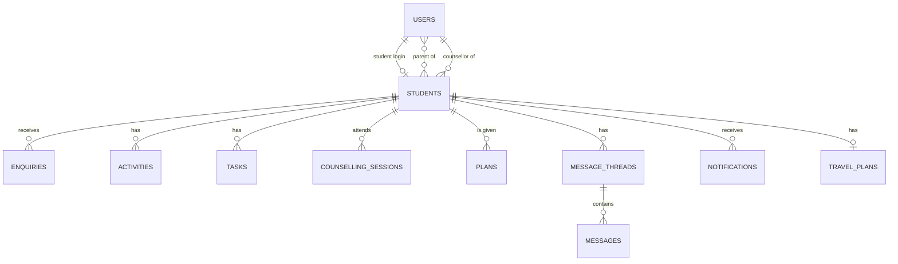
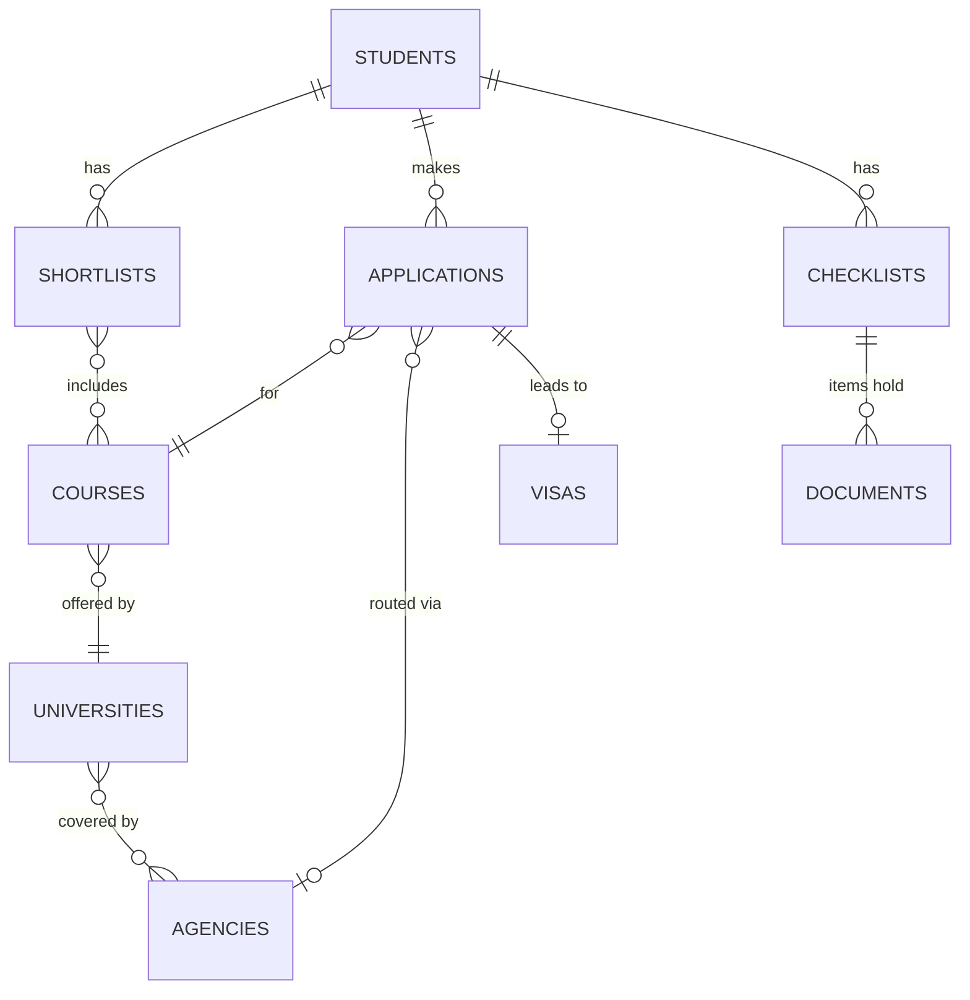
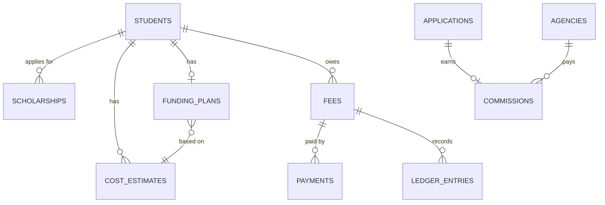

# AHatIn Student Portal — Data Model

**Prepared for:** The portal development team
**Date:** 21 October 2026
**Version:** 1.0

---

## 1. Purpose

This document defines how the portal stores its data in MongoDB: the collections, their fields, how they relate to each other, and their indexes. It is the reference for Beanie document models, database migrations and index creation.

---

## 2. Conventions

| Rule | Detail |
| --- | --- |
| Collection names | Lowercase, plural, snake_case (e.g. `ledger_entries`) |
| Field names | snake_case |
| IDs | `_id` is an `ObjectId`; references are named `<thing>_id` and hold an `ObjectId` |
| Standard fields | Every document has `created_at`, `updated_at` (UTC), `created_by`, `updated_by` (user `ObjectId`, or `"system"`) and `version` (integer, used to detect conflicting edits) |
| Dates | Stored as UTC `datetime`. A date with no time (e.g. a deadline day) is stored as a `YYYY-MM-DD` string with a separate `timezone` field where it matters |
| Money | An embedded `Money` object: `{ amount: int (minor units), currency: "INR" \| "GBP" \| "USD" \| "EUR" \| "CAD" \| "AUD" \| "NZD" }` |
| Enumerations | Stored as lowercase snake_case strings (e.g. `conditional_offer`) and validated against a fixed list |
| Deleting | Records are not deleted. They are deactivated, closed or anonymised. The only exceptions are the expiring collections in section 6 |
| Embed or reference | Data is embedded when it is always read with its parent and stays small (e.g. checklist items, status history). It is referenced when it grows without limit or is queried on its own (e.g. activities, documents) |
| Encrypted fields | Marked 🔒. Encrypted in the application before saving, with keys held in AWS KMS. **Deterministic** encryption (allows exact-match search and unique indexes) is marked 🔒D; **random** encryption (strongest; no search) is marked 🔒R |
| Validation | Each collection has a MongoDB JSON schema matching its Beanie model; both are generated from the same Pydantic model |

**Shared embedded types**

| Type | Fields |
| --- | --- |
| `Money` | `amount` (int), `currency` (string) |
| `StatusChange` | `from` (string), `to` (string), `at` (datetime), `by` (ObjectId), `reason` (string, optional) |
| `FileRef` | `storage_key` (string), `file_name` (string, display only), `mime_type`, `size_bytes` (int), `sha256` (string), `scan_status` (`pending` \| `clean` \| `infected` \| `failed`), `uploaded_by` (ObjectId), `uploaded_at` |
| `Acceptance` | `document_type` (`terms` \| `privacy` \| `commission_disclosure`), `version` (string), `accepted_by` (ObjectId), `accepted_at`, `ip`, `channel` |

---

## 3. Relationships

**People, follow-ups and messages**

**Shortlists, applications and documents**

**Funding, fees and commission**

One **student** record exists per person from first enquiry onwards (stage `new_lead`). When the person registers, a **user** login is created and linked. There is no separate "leads" collection, which keeps one record per person.

---

## 4. Collections

### 4.1 People and access

#### `users`
Login identities for every role.

| Field | Type | Req | Notes |
| --- | --- | --- | --- |
| role | enum | ✔ | `student`, `parent`, `counsellor`, `officer`, `admin` |
| name | string | ✔ | |
| email | string | | Lowercase; required for staff |
| mobile | string | | E.164 format |
| status | enum | ✔ | `invited`, `active`, `deactivated` |
| google_sub | string | | Staff only; Google account ID |
| student_id | ObjectId | | Student role: their student record |
| linked_student_ids | ObjectId[] | | Parent role: the students they are linked to |
| capacity | int | | Counsellors: max active students |
| temporary_access | object[] | | `{ student_owner_id, until }`, for leave cover |
| notification_prefs | object | | Per-channel opt-outs for marketing messages |
| last_login_at | datetime | | |

| Index | Type |
| --- | --- |
| `email` | Unique, partial (where email exists) |
| `mobile` | Unique, partial (where mobile exists) |
| `google_sub` | Unique, partial |
| `role, status` | Compound |
| `linked_student_ids` | Multikey |

#### `sessions`

| Field | Type | Req | Notes |
| --- | --- | --- | --- |
| session_hash | string | ✔ | SHA-256 of the cookie value; the raw value is never stored |
| user_id | ObjectId | ✔ | → users |
| csrf_token_hash | string | ✔ | |
| last_seen_at | datetime | ✔ | Used for idle timeout |
| expires_at | datetime | ✔ | Absolute timeout |
| ip, user_agent | string | | |

| Index | Type |
| --- | --- |
| `session_hash` | Unique |
| `user_id` | Standard (log out all devices) |
| `expires_at` | TTL (expire at the stored time) |

#### `otp_codes`

| Field | Type | Req | Notes |
| --- | --- | --- | --- |
| identifier | string | ✔ | Normalised email or mobile |
| code_hash | string | ✔ | Hashed with a secret; the code is never stored |
| channel | enum | ✔ | `email`, `sms`, `whatsapp` |
| attempts | int | ✔ | Max 5 |
| expires_at | datetime | ✔ | 10 minutes after creation |

| Index | Type |
| --- | --- |
| `identifier, created_at` | Compound (rate limits, latest code) |
| `expires_at` | TTL |

### 4.2 Students, enquiries and follow-ups

#### `students`
The central record for each person, from enquiry to alumni.

| Field | Type | Req | Notes |
| --- | --- | --- | --- |
| reference | string | ✔ | e.g. `AH-2026-00042`, from `counters` |
| name | string | ✔ | |
| email | string | | Lowercase |
| mobile | string | | E.164 |
| city | string | | |
| source | object | ✔ | Write-once: `{ channel, utm_source, utm_medium, utm_campaign, utm_term, utm_content, landing_page, referrer, referred_by_student_id }` |
| interests | object | | `{ level, countries[], intake (YYYY-MM), subject_areas[], budget_band, test_status }` |
| score | int | | Readiness score 0–100 |
| stage | enum | ✔ | `new_lead`, `contacted`, `assessment_booked`, `assessed`, `registered`, `documents_shortlist`, `applications_submitted`, `offer_accepted`, `visa_filed`, `visa_granted`, `arrived`, `enrolled`, `settled` |
| side_state | object | | `{ state: nurture \| on_hold \| deferred \| visa_refused \| lost, reason, until (date), set_at, set_by }` |
| stage_history | StatusChange[] | ✔ | |
| counsellor_id | ObjectId | | → users |
| officer_id | ObjectId | | → users |
| assignment_history | object[] | | `{ counsellor_id, officer_id, at, by, reason }` |
| user_id | ObjectId | | → users, set on registration |
| parent_user_ids | ObjectId[] | | → users, max 3 |
| acceptances | Acceptance[] | | Registration and parent acceptances |
| profile | object | | `{ name_as_passport, date_of_birth 🔒R, gender, nationality, address, passport_number 🔒D, passport_expiry, locked_fields[] }` |
| education | object[] | | `{ level, institution, board_or_university, subject, start, end, grade_type, grade_value, grade_scale }` |
| tests | object[] | | `{ test, format, score, sub_scores, test_date, expiry_date, status: planned \| booked \| taken }` |
| experience | object[] | | `{ employer, role, start, end }` |
| career_profile | object | | `{ goals, interests[], strengths[], industries[], recommended_courses: [{ area, reason, careers }] }` |
| assessment | object | | `{ profile_score, notes, assessed_at, assessed_by }` |
| services | object[7] | ✔ | `{ code: S1..S7, status: not_started \| in_progress \| completed \| not_needed, started_at, completed_at, summary, next_action, next_deadline, override: { status, reason, by, at } }` |
| profile_completeness | int | | 0–100 |
| anonymised_at | datetime | | Set when personal data is removed |

| Index | Type |
| --- | --- |
| `reference` | Unique |
| `email` | Partial (where exists), for duplicate checks |
| `mobile` | Partial (where exists), for duplicate checks |
| `profile.passport_number` | Unique, partial (deterministic encryption allows this) |
| `counsellor_id, stage` | Compound (counsellor lists) |
| `officer_id, stage` | Compound |
| `stage, interests.intake` | Compound (dashboards) |
| `side_state.state, side_state.until` | Compound (nurture re-contact jobs) |
| `services.code, services.status` | Multikey compound (tracker filters) |
| `source.channel, created_at` | Compound (reports) |
| Atlas Search `students_search` | On `name`, `email`, `mobile`, `reference` |

#### `enquiries`
Each form submission or manually added enquiry. Several can belong to one student.

| Field | Type | Req | Notes |
| --- | --- | --- | --- |
| student_id | ObjectId | ✔ | → students |
| form_type | enum | ✔ | `enquiry`, `free_assessment`, `contact`, `webinar`, `callback`, `manual` |
| channel | enum | ✔ | `website`, `phone`, `whatsapp`, `walk_in`, `event`, `seminar`, `referral`, `other` |
| payload | object | ✔ | Fields as submitted |
| consent | object | ✔ | `{ given: true, notice_version, at, ip }` |
| utm, page_url, referrer | object / string | | |
| was_duplicate | bool | ✔ | True if attached to an existing student |

| Index | Type |
| --- | --- |
| `student_id, created_at` | Compound |
| `created_at` | Standard (reports) |

#### `activities`
Contact attempts, notes and other timeline events.

| Field | Type | Req | Notes |
| --- | --- | --- | --- |
| student_id | ObjectId | ✔ | |
| type | enum | ✔ | `call`, `whatsapp`, `email`, `meeting`, `note`, `system` |
| outcome | enum | | `reached`, `no_answer`, `wrong_number`, `call_back_later`, `not_interested` |
| notes | string | | Max 5,000 characters |
| actor_id | ObjectId | ✔ | |
| task_id | ObjectId | | The task this completed |

| Index | Type |
| --- | --- |
| `student_id, created_at` | Compound (timeline, newest first) |

#### `tasks`

| Field | Type | Req | Notes |
| --- | --- | --- | --- |
| student_id | ObjectId | ✔ | |
| assignee_id | ObjectId | ✔ | → users |
| type | enum | ✔ | `call`, `whatsapp`, `email`, `meeting`, `check_in`, `review`, `other` |
| title | string | ✔ | |
| due_at | datetime | ✔ | |
| rule_code | string | | Set when created by a follow-up rule |
| priority | enum | ✔ | `normal`, `urgent` |
| status | enum | ✔ | `open`, `done`, `cancelled` |
| breached_at | datetime | | Set when overdue past the rule's limit |
| escalated_to | ObjectId[] | | |
| completed_at | datetime | | |

| Index | Type |
| --- | --- |
| `assignee_id, status, due_at` | Compound ("Today" list) |
| `status, due_at` | Compound (scheduler: overdue checks) |
| `student_id, status` | Compound |
| `rule_code, student_id, status` | Compound (avoid duplicate rule tasks) |

#### `follow_up_rules`
Admin-editable follow-up timings.

| Field | Type | Req | Notes |
| --- | --- | --- | --- |
| code | string | ✔ | e.g. `new_lead_first_contact` |
| trigger | string | ✔ | Event name |
| action | string | ✔ | Task title |
| offsets | object[] | ✔ | `{ minutes, working_hours_only: bool }` (several = several reminders) |
| escalate_after_minutes | int | | |
| escalate_to_role | enum | | `admin` |
| active | bool | ✔ | |

| Index | Type |
| --- | --- |
| `code` | Unique |
| `trigger, active` | Compound |

#### `settings`
A single document (`_id: "global"`): working hours, holidays, quiet hours, retention periods, assignment rules, feature flags.

#### `counters`
`{ _id: "student_reference_2026", seq: int }`, incremented atomically to create references.

### 4.3 Counselling and selection

#### `counselling_sessions`

| Field | Type | Req | Notes |
| --- | --- | --- | --- |
| student_id | ObjectId | ✔ | |
| counsellor_id | ObjectId | ✔ | |
| starts_at, ends_at | datetime | ✔ | |
| mode | enum | ✔ | `online`, `office` |
| meeting_url | string | | |
| calendar_event_id | string | | Google Calendar |
| status | enum | ✔ | `booked`, `completed`, `cancelled`, `no_show` |
| notes | string | | Staff-only by default |
| shared_with_student | bool | ✔ | |

| Index | Type |
| --- | --- |
| `counsellor_id, starts_at` | Unique, partial (status = booked): no double booking |
| `student_id, starts_at` | Compound |

#### `plans`
Recommended plan shared with the student; a new version each time it is republished.

| Field | Type | Req | Notes |
| --- | --- | --- | --- |
| student_id | ObjectId | ✔ | |
| version | int | ✔ | |
| course_areas | object[] | ✔ | `{ area, reason, careers }` |
| countries | object[] | ✔ | `{ country_code, reason }` |
| intake | string | ✔ | YYYY-MM |
| target_universities | ObjectId[] | | → universities |
| tests | object[] | | `{ test, target_score, planned_date }` |
| timeline | object[] | | `{ milestone, date }` |
| initial_cost_estimate | Money | | |
| published_at | datetime | | |

| Index | Type |
| --- | --- |
| `student_id, version` | Unique |

#### `countries`

| Field | Type | Req | Notes |
| --- | --- | --- | --- |
| code | string | ✔ | ISO 3166 alpha-2 |
| name | string | ✔ | |
| currency | string | ✔ | |
| typical_living_cost | Money | | Per year |
| post_study_work | string | | |
| visa_notes | string | | |
| intakes | string[] | | Months |

Index: `code` unique.

#### `universities`

| Field | Type | Req | Notes |
| --- | --- | --- | --- |
| name | string | ✔ | |
| country_code | string | ✔ | |
| city | string | | |
| agency_ids | ObjectId[] | | → agencies that cover it |
| earns_commission | bool | ✔ | Shown to students as a flag only |
| website | string | | |
| active | bool | ✔ | |

| Index | Type |
| --- | --- |
| `country_code, name` | Unique |
| `agency_ids` | Multikey |

#### `courses`

| Field | Type | Req | Notes |
| --- | --- | --- | --- |
| university_id | ObjectId | ✔ | |
| name | string | ✔ | |
| level | enum | ✔ | `foundation`, `undergraduate`, `postgraduate`, `mba`, `phd` |
| subject_area | string | ✔ | |
| duration_months | int | | |
| tuition | Money | | Per year |
| intakes | object[] | | `{ month, deadline }` |
| requirements | object | | `{ academic, english: [{ test, min_score }], other }` |
| published | bool | ✔ | Shown in the website widget |

| Index | Type |
| --- | --- |
| `university_id` | Standard |
| `level, subject_area` | Compound |
| `published` | Partial (widget feed) |
| Atlas Search `courses_search` | On `name`, `subject_area`, university name (denormalised `university_name`) |

#### `shortlists`

| Field | Type | Req | Notes |
| --- | --- | --- | --- |
| student_id | ObjectId | ✔ | |
| version | int | ✔ | |
| options | object[] | ✔ | `{ option_id, course_id, university_id, intake, reason, earns_commission }` |
| status | enum | ✔ | `draft`, `awaiting_approval`, `approved`, `superseded` |
| approvals | Acceptance[] | | Student, and parent if under 18 |

| Index | Type |
| --- | --- |
| `student_id, version` | Unique |
| `student_id, status` | Compound |

### 4.4 Documents and checklists

#### `checklist_templates`

| Field | Type | Req | Notes |
| --- | --- | --- | --- |
| type | enum | ✔ | `documents`, `visa`, `pre_departure`, `post_arrival` |
| country_code | string | ✔ | |
| level | enum | | |
| visa_type | string | | |
| items | object[] | ✔ | `{ key, label, help, required, needs_upload, completed_by: student \| staff, has_expiry }` |
| version | int | ✔ | |
| active | bool | ✔ | |

Index: `type, country_code, level, visa_type, active`.

#### `checklists`
A copy of a template given to one student.

| Field | Type | Req | Notes |
| --- | --- | --- | --- |
| student_id | ObjectId | ✔ | |
| type | enum | ✔ | As above |
| template_id, template_version | ObjectId, int | ✔ | |
| related_id | ObjectId | | Application or visa it belongs to |
| items | object[] | ✔ | Template item + `{ status: open \| done \| not_applicable, document_id, done_at, done_by, added_manually }` |
| progress | object | ✔ | `{ done, required }` |

| Index | Type |
| --- | --- |
| `student_id, type` | Compound |

#### `documents`

| Field | Type | Req | Notes |
| --- | --- | --- | --- |
| student_id | ObjectId | ✔ | |
| checklist_id, item_key | ObjectId, string | | Where it belongs |
| category | string | ✔ | e.g. `passport`, `transcript`, `bank_statement`, `sop`, `receipt` |
| versions | FileRef[] | ✔ | Newest last |
| status | enum | ✔ | `received`, `verified`, `rejected`, `expired` |
| status_history | StatusChange[] | ✔ | |
| rejection_reason | string | | |
| expiry_date | string | | YYYY-MM-DD |
| visibility | enum | ✔ | `student_and_staff`, `staff_only`, `admin_only` (agency agreements) |

| Index | Type |
| --- | --- |
| `student_id, category` | Compound |
| `status, expiry_date` | Compound (expiry reminders) |
| `versions.scan_status` | Partial (scan queue checks) |

### 4.5 Applications, agencies and visas

#### `agencies`

| Field | Type | Req | Notes |
| --- | --- | --- | --- |
| name | string | ✔ | |
| type | enum | ✔ | `aggregator`, `master_agent` |
| contacts | object[] | | `{ name, email, mobile, role }` |
| agreement | object | ✔ | `{ start, end, document_id }` |
| countries | string[] | ✔ | |
| commission_terms | object | ✔ | `{ type: percent \| fixed, value, currency, notes }` |
| payment_terms_days | int | | |
| status | enum | ✔ | `active`, `inactive` |

No credential fields are allowed (rejected by the schema).

| Index | Type |
| --- | --- |
| `name` | Unique |
| `status, agreement.end` | Compound (expiry warnings) |

#### `applications`

| Field | Type | Req | Notes |
| --- | --- | --- | --- |
| student_id | ObjectId | ✔ | |
| shortlist_id, option_id | ObjectId, string | ✔ | Must be from an approved shortlist |
| course_id, university_id | ObjectId | ✔ | |
| intake | string | ✔ | YYYY-MM |
| route | enum | ✔ | `agency`, `own` |
| agency_id | ObjectId | | Required when route = agency |
| agency_reference, agency_contact | string | | |
| university_reference | string | | |
| status | enum | ✔ | `draft`, `submitted`, `under_review`, `more_info_requested`, `interview`, `conditional_offer`, `unconditional_offer`, `accepted`, `declined`, `rejected`, `withdrawn` |
| status_history | StatusChange[] | ✔ | |
| submitted_at | datetime | | |
| deadlines | object[] | | `{ type: application \| acceptance \| deposit \| cas_request, date }` |
| offer | object | | `{ type, conditions: [{ text, status: pending \| met \| waived }], scholarship: Money, expires_on }` |
| deposit | object | | `{ amount: Money, due_on, paid_on, document_id }` |
| confirmation | object | | `{ kind: cas \| i20 \| admission_letter, number, issued_on, document_id }` |
| writing | object[] | | `{ kind: sop \| lor \| cv, document_id, comments[], approved }` |
| enrolment | object | | `{ confirmed_on, census_date }` |

| Index | Type |
| --- | --- |
| `student_id, status` | Compound |
| `agency_id, status` | Compound (agency reports) |
| `intake, status` | Compound (admissions reports) |
| `deadlines.date` | Multikey (deadline reminders) |
| `student_id, intake, status` | Partial unique where status = `accepted` (one accepted offer per intake) |

#### `visas`

| Field | Type | Req | Notes |
| --- | --- | --- | --- |
| student_id | ObjectId | ✔ | |
| application_id | ObjectId | ✔ | |
| country_code, visa_type | string | ✔ | |
| checklist_id | ObjectId | ✔ | |
| funds_check | object | | `{ held: Money, account_holder, held_from, result: pass \| shortfall, checked_by, checked_at }` |
| form_review | object | | `{ reviewed_by, reviewed_at }` |
| dates | object | | `{ applied_on, appointment_at, appointment_centre }` |
| reference | string | | |
| status | enum | ✔ | `preparing`, `filed`, `granted`, `refused` |
| status_history | StatusChange[] | ✔ | |
| refusal | object | | `{ reason, next_step: reapply \| appeal \| change_destination \| close }` |
| mock_interviews | object[] | | `{ at, interviewer_id, feedback }` |

| Index | Type |
| --- | --- |
| `student_id` | Standard |
| `status, dates.applied_on` | Compound |

### 4.6 Funding

#### `scholarships`

| Field | Type | Req | Notes |
| --- | --- | --- | --- |
| student_id | ObjectId | ✔ | |
| name, provider | string | ✔ | |
| application_id | ObjectId | | If tied to a university application |
| amount | Money | | |
| deadline | string | | YYYY-MM-DD |
| status | enum | ✔ | `planned`, `applied`, `awarded`, `rejected` |
| awarded | Money | | |

Index: `student_id, status`; `deadline` (reminders).

#### `cost_estimates`

| Field | Type | Req | Notes |
| --- | --- | --- | --- |
| student_id | ObjectId | ✔ | |
| option_id | string | | Shortlist option |
| items | object[] | ✔ | `{ kind: tuition \| living \| visa \| health \| travel \| deposit \| other, amount: Money, note }` |
| total_local | Money | ✔ | Calculated |
| total_inr | Money | ✔ | Calculated |
| rate_used | object | ✔ | `{ currency, rate, effective_on }` |

Index: `student_id`.

#### `funding_plans`
One per student.

| Field | Type | Req | Notes |
| --- | --- | --- | --- |
| student_id | ObjectId | ✔ | |
| cost_estimate_id | ObjectId | ✔ | |
| sources | object[] | ✔ | `{ kind: family \| sponsor \| scholarship \| loan \| other, amount: Money, note }` |
| gap_inr | Money | ✔ | Calculated |
| proof_of_funds | object | | `{ required: Money, account_holder, hold_from, planned_visa_date }` |

Index: `student_id` unique.

#### `exchange_rates`

| Field | Type | Req | Notes |
| --- | --- | --- | --- |
| currency | string | ✔ | |
| rate_to_inr | decimal | ✔ | Up to 6 decimal places |
| effective_on | string | ✔ | YYYY-MM-DD |

Index: `currency, effective_on` unique.

### 4.7 Departure and arrival

#### `travel_plans`
One per student.

| Field | Type | Req | Notes |
| --- | --- | --- | --- |
| student_id | ObjectId | ✔ | |
| departure_on | string | | YYYY-MM-DD |
| flight | string | | |
| arrival_airport | string | | |
| arrival_at_local | string | | ISO local date-time |
| arrival_timezone | string | | e.g. `Europe/London` |
| arrival_at_utc | datetime | | Calculated; drives the arrival check |
| address | object | | |
| contacts | object[] | | `{ name, relation, phone, kind: local \| emergency }` |
| arrival_confirmed_at | datetime | | |

Index: `student_id` unique; `arrival_at_utc` partial (where not confirmed).

### 4.8 Fees and commission

#### `fee_types`
`{ code, name, default_payee, active }`; index `code` unique.

#### `fees`

| Field | Type | Req | Notes |
| --- | --- | --- | --- |
| student_id | ObjectId | ✔ | |
| fee_type | string | ✔ | → fee_types.code |
| related | object | | `{ kind: application \| visa, id }` |
| payee | string | ✔ | |
| amount | Money | ✔ | In the payee's currency |
| due_on | string | | |
| route | enum | ✔ | `direct`, `via_ahatin` |
| status | enum | ✔ | `due`, `receipt_uploaded`, `verified`, `payment_pending`, `received`, `paid_out`, `refunded`, `cancelled` |
| status_history | StatusChange[] | ✔ | |
| receipt_document_id | ObjectId | | Direct route |
| payout | object | | `{ paid_on, amount: Money, reference, document_id, by }` |

Index: `student_id, status`; `status, due_on`.

#### `payments`
One per Razorpay order.

| Field | Type | Req | Notes |
| --- | --- | --- | --- |
| fee_id | ObjectId | ✔ | |
| student_id | ObjectId | ✔ | |
| payer_user_id | ObjectId | ✔ | Student or parent |
| amount_inr | Money | ✔ | Set by the server |
| rate_used | object | ✔ | |
| razorpay_order_id | string | ✔ | |
| razorpay_payment_id | string | | |
| status | enum | ✔ | `created`, `captured`, `failed`, `refunded` |
| receipt_number | string | | |
| refunds | object[] | | `{ razorpay_refund_id, amount, reason, approved_by, status }` |
| processed_event_ids | string[] | | Razorpay webhook events already handled |

| Index | Type |
| --- | --- |
| `razorpay_order_id` | Unique |
| `razorpay_payment_id` | Unique, partial |
| `status, created_at` | Compound (15-minute reconciliation) |
| `fee_id` | Standard |

#### `ledger_entries`
Append-only. Written in the same transaction as the fee or payment change.

| Field | Type | Req | Notes |
| --- | --- | --- | --- |
| student_id | ObjectId | ✔ | |
| fee_id | ObjectId | ✔ | |
| kind | enum | ✔ | `received`, `paid_out`, `refunded`, `adjustment` |
| amount | Money | ✔ | |
| reference | string | | Payment, payout or refund reference |
| at | datetime | ✔ | |

Index: `student_id, at`; `fee_id`.

#### `commissions`

| Field | Type | Req | Notes |
| --- | --- | --- | --- |
| application_id | ObjectId | ✔ | |
| agency_id | ObjectId | ✔ | |
| student_id | ObjectId | ✔ | |
| expected | Money | ✔ | |
| expected_on | string | | |
| claims | object[] | | `{ claimed_on, amount, reference }` |
| receipts | object[] | | `{ received_on, amount, reference, statement_id }` |
| clawbacks | object[] | | `{ on, amount, reason }` |
| status | enum | ✔ | `expected`, `claimed`, `partly_received`, `received`, `clawed_back` |

Index: `application_id` unique; `agency_id, status`; `status, expected_on`.

#### `agency_statements`
`{ agency_id, period, file: FileRef, lines: [{ student_name, university, amount, matched_commission_id, match_status }] }`; index `agency_id, period` unique.

### 4.9 Messages and notifications

#### `message_threads`
`{ student_id, subject, tags: [support], urgency: normal | urgent, status: open | closed, last_message_at }`; index `student_id, status`; `tags, urgency, status`.

#### `messages`
`{ thread_id, sender_id, body (max 5,000), attachments: FileRef[], read_by: [{ user_id, at }] }`; index `thread_id, created_at`.

#### `notification_templates`
`{ event, channel, language, subject, body, whatsapp_template_name, sms_dlt_template_id, active }`; index `event, channel, language` unique.

#### `notifications`
Outbound log.

| Field | Type | Req | Notes |
| --- | --- | --- | --- |
| student_id | ObjectId | | |
| recipient_user_id | ObjectId | | |
| event | string | ✔ | |
| channel | enum | ✔ | `in_app`, `email`, `whatsapp`, `sms`, `push` |
| status | enum | ✔ | `queued`, `sent`, `delivered`, `read`, `failed` |
| attempts | int | ✔ | Max 3, then fall back to email |
| scheduled_for | datetime | | Respects quiet hours |
| provider_message_id | string | | |
| error | string | | |

Index: `recipient_user_id, channel, created_at` (in-app inbox); `status, scheduled_for` (sending queue); `provider_message_id` (delivery updates).

#### `push_subscriptions`
`{ user_id, endpoint, keys, user_agent }`; index `endpoint` unique; `user_id`.

### 4.10 Compliance and system

#### `consent_documents`
`{ type: terms | privacy | commission_disclosure, version, text, text_sha256, effective_from }`; index `type, version` unique.

#### `audit_events`
Append-only; no update or delete permission for the application's database user.

| Field | Type | Req | Notes |
| --- | --- | --- | --- |
| at | datetime | ✔ | |
| actor_id | ObjectId \| "system" | ✔ | |
| action | string | ✔ | e.g. `student.update`, `document.download`, `report.export` |
| entity | object | ✔ | `{ collection, id }` |
| changes | object | | `{ field: { before, after } }`, sensitive values masked |
| ip, user_agent, trace_id | string | | |

Index: `entity.collection, entity.id, at`; `actor_id, at`; `action, at`.

#### `data_requests`
`{ student_id, type: access | correction | deletion | consent_withdrawal, status: open | in_progress | completed | rejected, notes, export_file: FileRef, completed_at }`; index `status, created_at`.

#### `idempotency_keys`
`{ key, user_or_ip, request_hash, response, expires_at }`; index `key, user_or_ip` unique; `expires_at` TTL (24 hours).

---

## 5. Transactions

These changes are written together in one MongoDB transaction, so they succeed or fail as a whole:

| Change | Collections |
| --- | --- |
| Payment captured | `payments`, `fees`, `ledger_entries` |
| Payout or refund recorded | `fees`, `ledger_entries`, `payments` |
| Stage change | `students` (stage, history, services), `tasks` (rule tasks created or cancelled) |
| Record merge | `students`, `enquiries`, `activities`, `tasks`, `documents` and others re-pointed to the kept record |
| Registration | `users`, `students` |

Other updates use the `version` field: an update only applies if the version matches, otherwise the API returns a conflict.

---

## 6. Expiring data (TTL)

| Collection | Expires |
| --- | --- |
| `sessions` | At `expires_at` |
| `otp_codes` | At `expires_at` (10 minutes) |
| `idempotency_keys` | After 24 hours |

All other data follows the retention rules (anonymisation by a scheduled job), not automatic deletion.

---

## 7. Migrations and seed data

- Index and schema changes live in versioned migration scripts in the repository, run automatically on deploy, and must work with the previous release's code.
- Seed data for development and staging: roles, follow-up rules, settings, fee types, consent document drafts, sample countries, universities, courses and agencies, and fake students at every stage.
- Production seed: follow-up rules, settings, fee types, consent documents and checklist templates supplied by AHatIn.
