# AHatIn Student Portal — System Architecture

**Prepared for:** AHatIn management and the portal development team
**Date:** 21 October 2026
**Version:** 2.0

---

## 1. Purpose

This document shows how the portal is built: frontend, backend, database, hosting, login, outside services, and how the existing WordPress website connects to it. Each section starts with a short plain-language summary.

Flow charts use Mermaid. They display in GitHub, GitLab and VS Code (with a Mermaid extension).

---

## 2. The big picture

**In plain words:** The WordPress website stays as AHatIn's public website. Its enquiry form sends details straight to the portal. Students, parents and staff use the portal app. The portal's server keeps everything in a secure database in Mumbai and uses outside services for payments, messages and calendars.

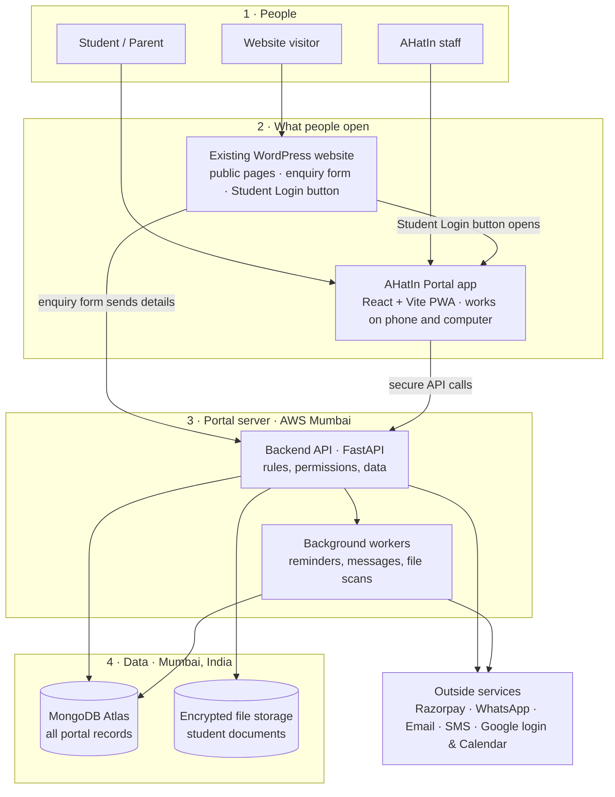

---

## 3. Frontend

**In plain words:** One web app serves everyone and shows each person only their own screens. It can be installed on a phone.

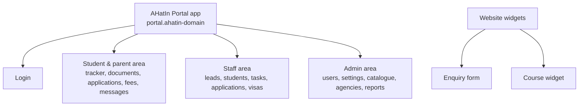

| Concern | Choice |
| --- | --- |
| Framework | React with TypeScript, built with Vite |
| Screens | Ready-made component library in AHatIn's colours; mobile-first |
| Data and forms | TanStack Query; React Hook Form with Zod |
| Installable app | `vite-plugin-pwa` (Workbox): manifest, service worker, web push |
| Widgets | Separate small Vite builds with isolated styles (Shadow DOM) |
| Delivery | Static files on Amazon S3 behind Amazon CloudFront |

---

## 4. Backend

**In plain words:** The backend is the portal's brain. It checks who is asking and whether they are allowed, then reads or writes data. Slow jobs, such as sending messages, go to background workers so nobody waits.

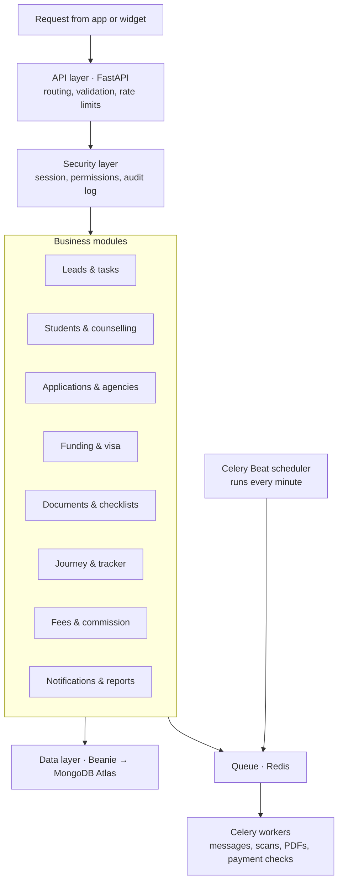

| Concern | Choice |
| --- | --- |
| Design | One well-organised application ("modular monolith"); easy to build and run, can be split later |
| Language | Python 3.12+, FastAPI, Pydantic |
| Database access | Beanie ODM on PyMongo's async driver |
| API | REST and JSON under `/api/v1`; public widget endpoints under `/api/public`; documentation generated automatically |
| Packaging | Docker images for the API, workers and scheduler |

---

## 5. Database and files

**In plain words:** All records live in one database. Documents are kept in separate encrypted storage and checked for viruses on upload.

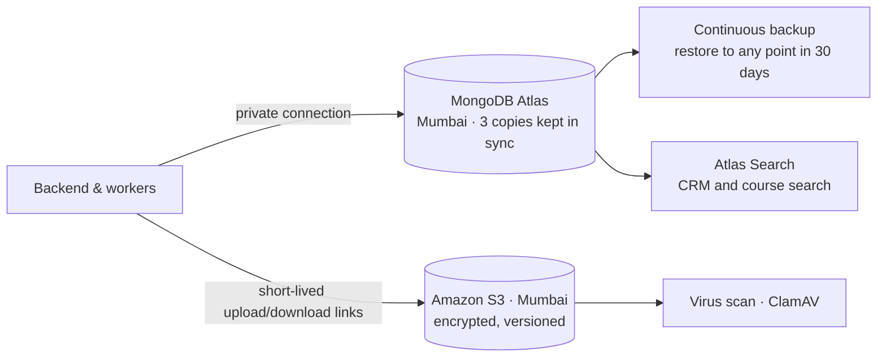

| Concern | Choice |
| --- | --- |
| Database tier | Dedicated MongoDB Atlas cluster (not the free shared tier) |
| Structure | Schema validation, indexes and data migrations defined in code |
| Sensitive fields | Extra encryption with keys in AWS Key Management Service |

---

## 6. Hosting and releases

**In plain words:** Everything runs on Amazon Web Services in Mumbai. A firewall filters harmful traffic, the app's screens load fast from a content delivery network, and the server runs in containers that restart themselves if something fails.

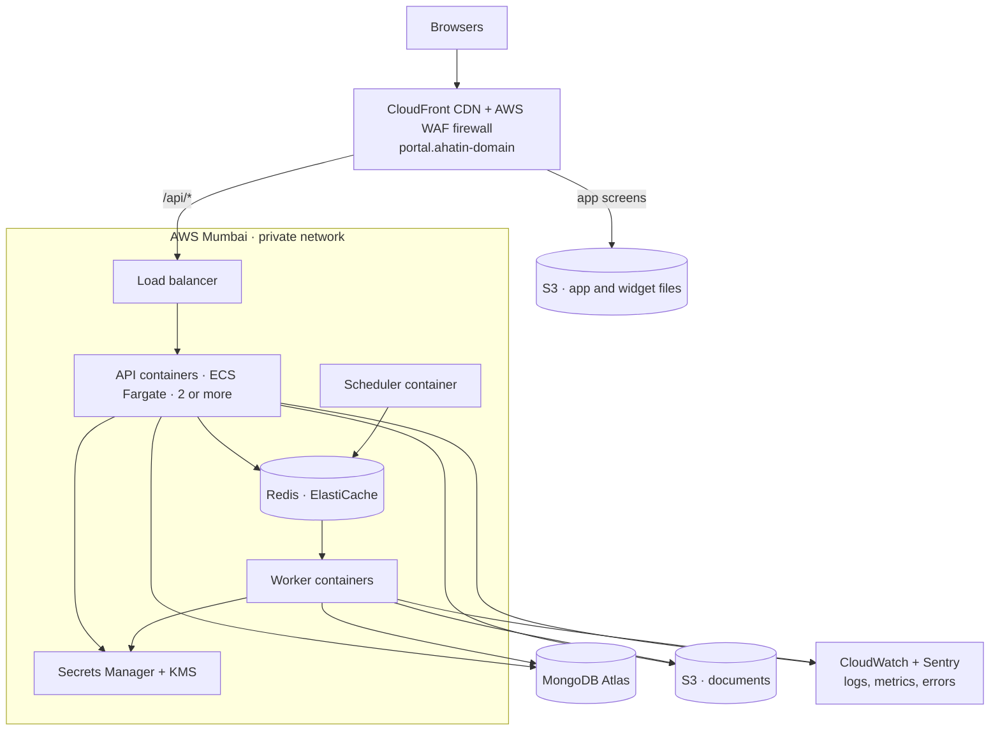

| Concern | Choice |
| --- | --- |
| Region | AWS Mumbai (ap-south-1) for all personal data, backups and logs |
| Address | `portal.<ahatin-domain>` serves both the app and the API, so login cookies stay simple and secure |
| Scaling | Containers scale automatically across two availability zones |
| Email | Amazon SES with SPF, DKIM and DMARC on AHatIn's domain |
| Monitoring | Alarms and uptime checks |
| Setup | Terraform, so every environment is built the same way |

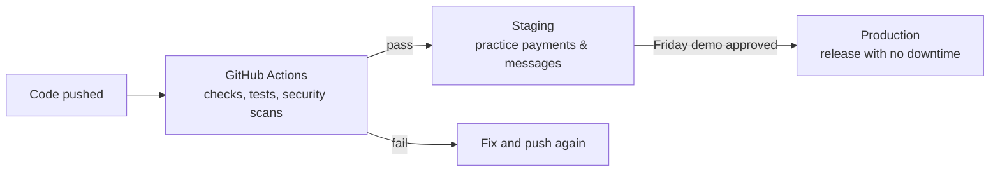

| Environment | Used for | Data |
| --- | --- | --- |
| Development | Building | Fake data |
| Staging | Testing and demos | Fake or anonymised data |
| Production | Live portal | Real data |

---

## 7. Login

**In plain words:** Students and parents log in with a one-time code, so there are no passwords to forget. Staff use their AHatIn Google account with 2-step verification. After login, the browser keeps a secure session that scripts can't read.

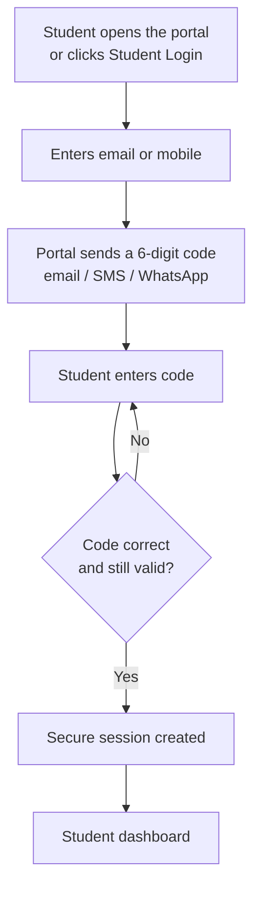

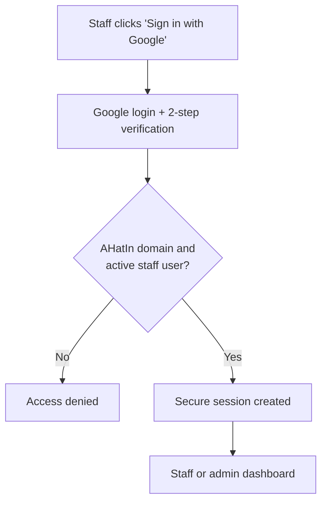

Sessions are stored in MongoDB (with automatic expiry) and cached in Redis, so a session can be ended instantly.

---

## 8. Outside services

**In plain words:** The portal uses trusted services rather than building everything itself. If one is down, the portal keeps working and tries again later.

| Service | Used for |
| --- | --- |
| Razorpay | Third-party fee payments and refunds |
| WhatsApp Business API (approved provider) | Messages, reminders, login codes |
| Amazon SES | Email |
| SMS gateway (registered on India's DLT system) | Login codes and urgent alerts |
| Google | Staff login; Calendar and Meet links |
| Zoom (optional) | Video meetings |
| Web push | App notifications |
| Cloudflare Turnstile | Spam protection on the website form |
| Google Analytics 4 | Following visitors from website to portal |
| Sentry | Error tracking |

### 8.1 Paying a fee

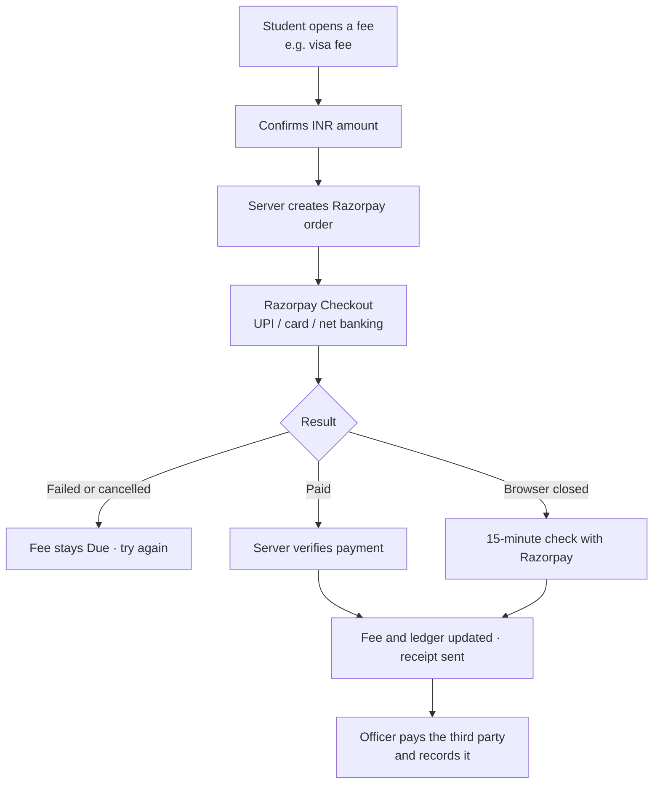

### 8.2 Sending messages and reminders

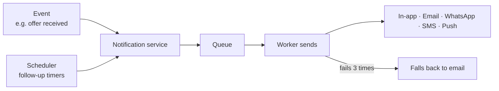

---

## 9. WordPress and the portal

**In plain words:** WordPress keeps its public pages, blogs and search ranking, and never stores student data. The small additions below connect it to the portal.

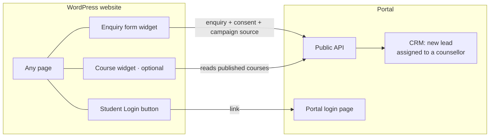

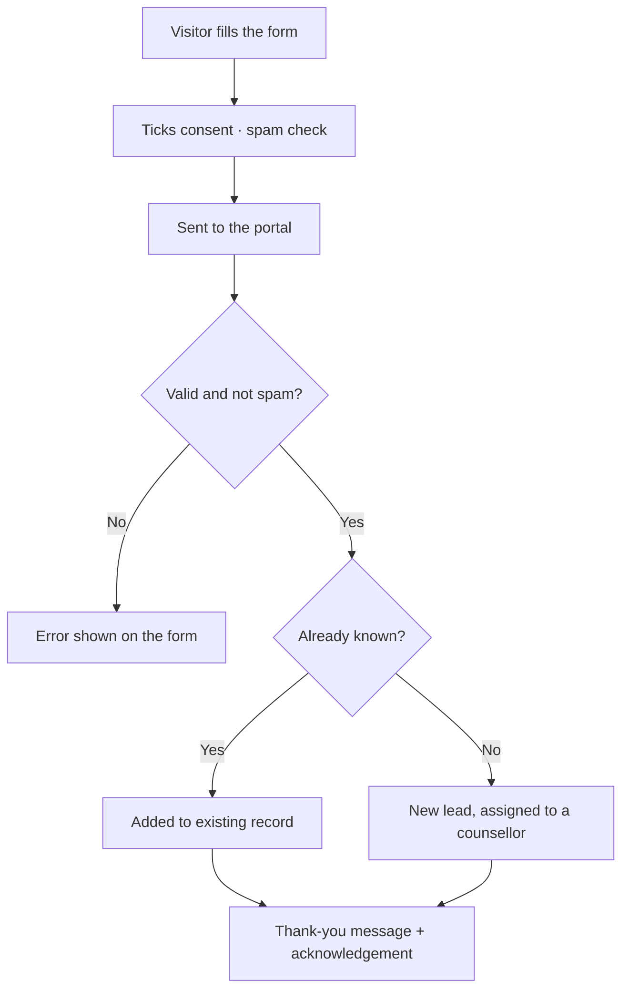

**Changes on WordPress:**

| Change | How |
| --- | --- |
| Enquiry form (including Contact Us) | Paste one `
` and one `<script>` tag |
| Course widget (optional) | Script tag on course pages |
| Student Login button | Menu link to `portal.<ahatin-domain>/login` |
| Analytics | One Google Analytics 4 property across both sites |
| Old forms | Kept until the new form is confirmed working, then removed |

---

## 10. Glossary

| Term | Meaning |
| --- | --- |
| API | The addresses the app and widgets use to talk to the server |
| CDN | Servers worldwide that deliver the app's files quickly |
| PWA | A website that can be installed and used like a phone app |
| Widget | A small part of the portal placed inside a WordPress page |
| Worker | A background process for slow jobs |
| Webhook | A message an outside service sends when something happens |
| WAF | A firewall that filters harmful web traffic |
| Replica set | Three synced copies of the database, so one can fail safely |
| DLT | India's registration system for business SMS |
