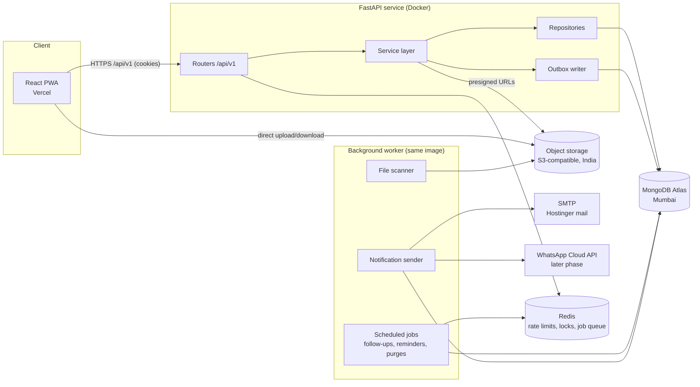
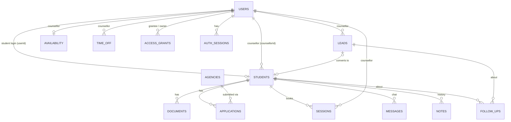
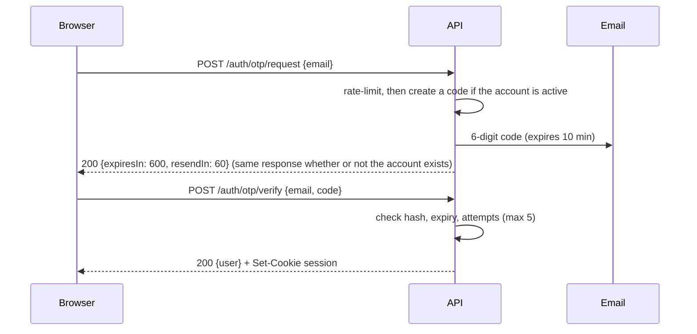
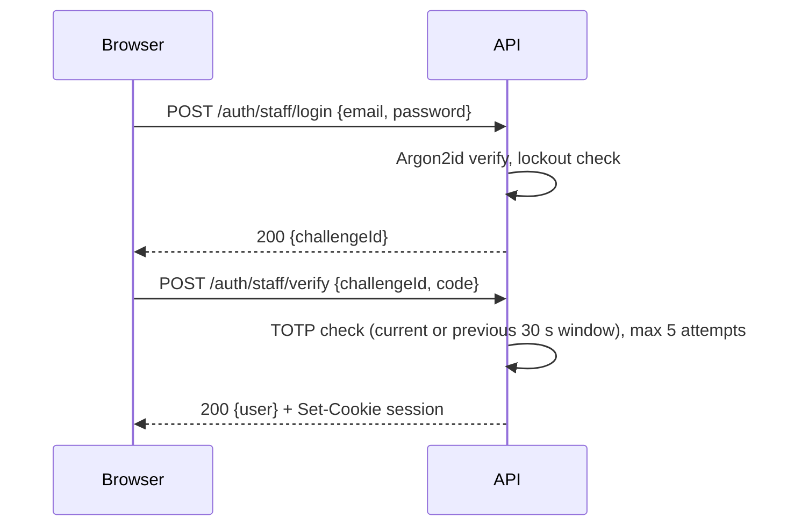
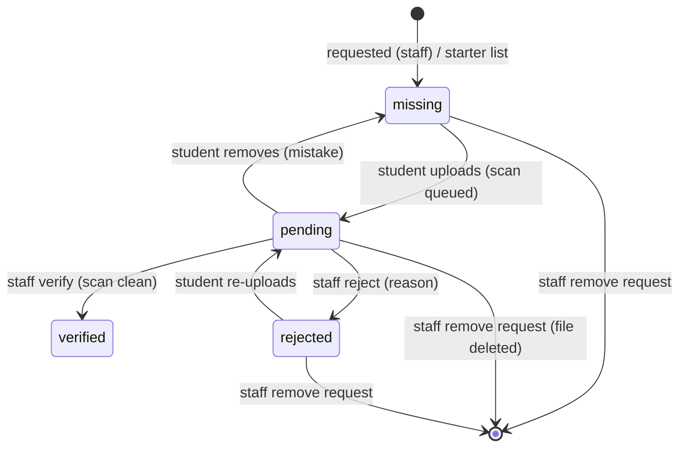
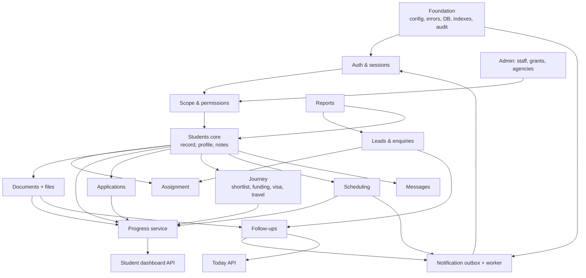

# AHat Portal — Backend Implementation Guide

Version 1.0 · 25 October 2026 · Derived from the `ahat-in-demo` frontend (React + Vite + PWA)

This guide describes everything the backend must do so the existing frontend can switch from its in-browser demo data to a real server. It is written to be built from directly: every screen, form and rule in the frontend is covered, with the data it needs and the API that provides it.

---

## Contents

1. [Backend Overview](#1-backend-overview)
2. [Assumptions](#2-assumptions)
3. [Database Design](#3-database-design)
4. [Authentication & Authorization](#4-authentication--authorization)
5. [API Conventions](#5-api-conventions)
6. [API Specification](#6-api-specification)
7. [Business Logic](#7-business-logic)
8. [File & Media Management](#8-file--media-management)
9. [Notifications](#9-notifications)
10. [Integrations](#10-integrations)
11. [Backend Development Roadmap](#11-backend-development-roadmap)
12. [Deployment](#12-deployment)
13. [Appendix: Frontend Screen → API Map](#13-appendix-frontend-screen--api-map)

---

## 1. Backend Overview

### 1.1 What the backend serves

| Area | Users | What they do |
| --- | --- | --- |
| Public website | Visitors | Read the website, send an enquiry (no account) |
| Student portal | Students (and later parents) | Register and log in with an emailed one-time code; follow progress through seven services; upload documents; review and approve a university shortlist; accept or decline offers; plan funding; follow the visa; tick a travel checklist; confirm arrival; book sessions; chat with their counsellor |
| Staff portal | Counsellors, application officers | Log in with password + authenticator code; work through follow-ups; manage leads and students; verify documents; manage applications, visa and the whole journey; manage availability, time off and sessions; reply to messages |
| Admin area | Administrators | Everything staff can do for all students, plus staff accounts, temporary cover access, partner agencies, settings, reassignment and reports |

**Frontend-only (no backend needed):**
- **Static website content:** destinations, the nine homepage services, the "About" section, the QS-ranked university list, testimonials, FAQs, headline figures, contact details and the hero preview card are fixed content in the React app.
- **PWA:** the offline app shell, cached fonts and images, and the "new version available" prompt are handled by the service worker.
- **Screen behaviour:** the welcome banner after registration, the dashboard's two-column balancing, the compact or expanded shortlist view, Enter-to-send in chat, and the destination pre-selection from "Get guidance" links.
- **Demo-only tools, not built in the backend:**
  - on-screen codes and "Fill it in" buttons;
  - demo account hints on the login pages;
  - **Admin → Settings → Reset demo data**;
  - the browser data store and its seed merge.

### 1.2 System architecture



- **One API service and one worker**, built from the same codebase and Docker image, started with different commands.
- **The frontend calls `/api/v1/...` on the same site.** Vercel rewrites `/api/*` to the API service, so session cookies are first-party (see 4.3). The frontend already sends `credentials: 'include'` and uses relative `/api/v1` paths.
- **Files never pass through the API.** The API issues short-lived presigned URLs, and the browser uploads to and downloads from object storage directly.
- **Notifications are asynchronous** (outbox pattern): the API writes a notification record in the same transaction as the business change, and the worker sends it.

### 1.3 Recommended tech stack

| Concern | Choice | Notes |
| --- | --- | --- |
| Language / framework | **Python 3.12, FastAPI** | Async, Pydantic v2 validation, OpenAPI docs generated automatically |
| Database | **MongoDB Atlas** (M10+ in `ap-south-1` Mumbai) | Multi-document transactions on a replica set; data stays in India |
| ODM / driver | **Motor** (async PyMongo) with Pydantic models, or **Beanie** | Repositories wrap all queries; no queries in routers |
| Cache / rate limits / jobs | **Redis** (managed, e.g. Upstash or Redis Cloud, Mumbai) | Rate limiting, distributed locks, job queue |
| Background jobs | **ARQ** (async Redis queue) with cron jobs | Same codebase as the API |
| Password hashing | **argon2-cffi** (Argon2id) | |
| Authenticator codes | **pyotp** (RFC 6238 TOTP, 30 s, 6 digits) | |
| Secrets at rest | **cryptography** (Fernet/AES-GCM) for TOTP secrets | Key from environment |
| Object storage | **S3-compatible**, India region (AWS S3 `ap-south-1` or equivalent) | Private bucket, presigned URLs |
| Malware scanning | **ClamAV** (sidecar container) | Scans every upload before staff can open it |
| Email | **SMTP via Hostinger business mail** (aiosmtplib) | Templated with Jinja2 |
| Calendar invites | **icalendar** (`.ics` attachments) | |
| Errors / monitoring | **Sentry**, structured JSON logs | `trace_id` on every request |
| Testing | **pytest**, httpx `AsyncClient`, **mongomock-motor** or a test Atlas/Testcontainers MongoDB | |
| Lint / format / types | **ruff**, **mypy** (strict) | |

### 1.4 Project structure

```
ahat-api/
├── app/
│   ├── main.py                 # FastAPI app, middleware, router registration
│   ├── config.py               # Settings (pydantic-settings) from environment
│   ├── core/
│   │   ├── security.py         # Argon2, TOTP, token generation, encryption
│   │   ├── sessions.py         # Session cookie create/read/rotate/revoke
│   │   ├── permissions.py      # Role checks + student "scope" (own / covered / all)
│   │   ├── errors.py           # ApiError + exception handlers (error format, trace_id)
│   │   ├── ratelimit.py        # Redis-backed limiter
│   │   ├── clock.py            # now() in UTC + IST helpers (testable)
│   │   └── audit.py            # Audit log writer
│   ├── db/
│   │   ├── client.py           # Motor client, transactions helper
│   │   ├── indexes.py          # All indexes, created on startup
│   │   └── counters.py         # Student reference sequence
│   ├── models/                 # Pydantic models: one file per collection
│   ├── schemas/                # Request/response models (camelCase aliases)
│   ├── repositories/           # Data access, one per collection
│   ├── services/               # Business logic (see section 7)
│   │   ├── auth_service.py
│   │   ├── enquiry_service.py
│   │   ├── assignment_service.py
│   │   ├── student_service.py
│   │   ├── journey_service.py  # Shortlist, funding, visa, departure, arrival, overrides
│   │   ├── progress_service.py # Computes the seven service statuses
│   │   ├── document_service.py
│   │   ├── application_service.py
│   │   ├── scheduling_service.py
│   │   ├── message_service.py
│   │   ├── lead_service.py
│   │   ├── followup_service.py
│   │   ├── notification_service.py
│   │   └── report_service.py
│   ├── routers/
│   │   ├── auth.py  public.py  student.py  staff_students.py  staff_leads.py
│   │   ├── staff_schedule.py  staff_messages.py  staff_today.py  admin.py
│   ├── workers/
│   │   ├── main.py             # ARQ worker settings + cron schedule
│   │   ├── notifications.py    # Outbox sender (email now, WhatsApp later)
│   │   ├── followups.py        # Overdue checks, escalations
│   │   ├── reminders.py        # Session + deadline reminders
│   │   ├── files.py            # Virus scan + checksum
│   │   └── cleanup.py          # Purge expired codes, unverified accounts
│   └── templates/email/        # Jinja2 email templates (HTML + text)
├── tests/                      # unit/ (services) and api/ (routers)
├── scripts/
│   ├── seed_dev.py             # Demo data equivalent to the frontend demo
│   └── create_admin.py         # First admin account (prints TOTP setup URI)
├── Dockerfile
├── docker-compose.yml          # api, worker, mongo, redis, clamav, mailpit (local)
├── pyproject.toml
└── .env.example
```

---

## 2. Assumptions

The frontend is a working demo whose data lives in the browser. Where it didn't show a rule, these assumptions apply. Each is marked **[A#]** where it's used.

| # | Assumption |
| --- | --- |
| A1 | **JSON field names are camelCase**, matching the frontend's TypeScript types. Requests also accept snake_case for the same fields (the frontend's staff verify call sends `challenge_id`). The **error body keeps its existing keys** (`detail`, `errors`, `trace_id`), which the frontend already parses. |
| A2 | **All times are stored in UTC.** Session `date` (YYYY-MM-DD) and `time` (HH:MM) are **India Standard Time** (Asia/Kolkata), because the frontend shows "IST"; the backend also stores a computed `startsAt`/`endsAt` in UTC for queries and reminders. Working hours, quiet hours and "working day" limits use IST. |
| A3 | **Registration creates the account in a pending state.** It becomes active when the emailed code is verified; unverified accounts are deleted after 24 hours. |
| A4 | **Application officers** can see and work on **all students'** documents, applications and visa, but not leads, availability or reassignment. Counsellors see their own students plus anyone they're covering for. Admins see everything. |
| A5 | **Parents** have read-only access to one or more linked students' dashboards (the frontend reserves the `parent` role and the website mentions parent access). Invitation and linking is a later phase. |
| A6 | **Staff accounts are created by an admin** and activated through an emailed invite link where the person sets a password and scans the authenticator QR code. The frontend doesn't yet have these two screens (set password, enrol authenticator); they are required frontend work. |
| A7 | **The student's profile** (date of birth, education, English test, etc.) is stored on the server in the student record and is visible to staff. In the demo it was browser-only. **New students start with an empty profile** (English test "Not taken yet", every other field blank), which triggers the "Complete your profile" notification. |
| A17 | **The student's `goal`, `destination` and `intake`** (shown at the top of the staff record and in the students list) come from registration and then follow the student's profile: saving the profile sets `goal` = `courseInterest`, `destination` and `intake` when those fields are filled in. Staff can't edit them directly in release 1; the frontend has no screen for it. |
| A8 | **Partner agencies** are managed by admins (create, edit, deactivate). The demo shows a read-only list. |
| A9 | **Settings** (working hours, quiet hours, staff security, follow-up rules) are stored in a settings document and are read-only in the first release; editing is a later phase. |
| A10 | **Student references** are `AH-<year>-<5-digit sequence>`, unique, sequence restarting each calendar year. |
| A11 | **One active counsellor per student and per lead.** Reassignment is admin-only, with a reason. |
| A12 | **Payments are out of scope for the first release.** The consultancy is free; only third-party fees (application, visa, health surcharge) may be collected later, through Razorpay. |
| A13 | **Meeting links:** each counsellor has one Google Meet link stored on their profile (a "Join meeting" button opens it). Link management screens are a later phase; until then admins set links through the API or a script. |
| A14 | **No WordPress dependency.** The public website and enquiry form are served by the React app; if a WordPress site is used later, its form posts to the same public enquiry endpoint. |
| A15 | **Counsellors are staff users with role `counsellor`.** The demo's separate counsellor list (`c1`, `c2`, `c3`) maps to staff user IDs. |
| A16 | **Session lengths** come from the counsellor's availability settings at booking time and are stored on the session. |

---

## 3. Database Design

### 3.1 Entities and relationships



Embedded (inside the student document, because each is small and always read with the student): **profile**, **assignment history**, **journey** (career plan, shortlist with its options and comments, funding plan, scholarships, visa, departure checklist, arrival, overrides).

Separate collections (because they grow or are queried on their own): documents, applications, sessions, messages, notes, follow-ups, leads, availability, time off, access grants, agencies, auth codes and sessions, notifications, audit log.

### 3.2 Common conventions

- `_id`: MongoDB ObjectId, returned to the frontend as a string `id`.
- `createdAt`, `updatedAt`: UTC datetimes on every document.
- `version`: integer on documents that staff and students edit concurrently (students, applications, sessions); updates use `{_id, version}` filters and increment it, returning `409` on a mismatch (optimistic locking).
- Enumerations are stored as lowercase snake_case strings.
- Money in **₹ lakh** is stored as a decimal number with one decimal place (the frontend works in lakh).

### 3.3 Collections and schemas

Field types: `str`, `int`, `float`, `bool`, `date` (YYYY-MM-DD string), `time` (HH:MM string), `datetime` (UTC), `oid` (ObjectId), `[]` (array).

#### `users`
All logins: students, parents and staff.

| Field | Type | Rules |
| --- | --- | --- |
| `role` | str | `student` \| `parent` \| `counsellor` \| `officer` \| `admin` |
| `name` | str | 2–100 chars, letters, spaces, `.` `'` `-` |
| `email` | str | lowercased, unique |
| `mobile` | str | E.164, Indian numbers stored as `+91XXXXXXXXXX` |
| `status` | str | `pending_verification` \| `active` \| `invited` \| `deactivated` |
| `emailVerifiedAt` | datetime? | |
| `studentReference` | str? | students only, e.g. `AH-2026-00042` |
| `passwordHash` | str? | staff only, Argon2id |
| `totpSecretEnc` | str? | staff only, encrypted |
| `totpEnrolledAt` | datetime? | |
| `failedPasswordCount` | int | resets on success |
| `lockedUntil` | datetime? | after 10 failed passwords: 15 minutes |
| `lastLoginAt` | datetime? | shown on Staff users |
| `counsellorProfile` | object? | counsellors: `{ phone, meetingLink, destinations[], acceptingNew, maxActiveStudents }` (meeting link and destination fields used in later phases) |
| `linkedStudentIds` | oid[] | parents only |
| `consent` | object? | students: `{ terms: bool, contact: bool, at: datetime, version: str }` |

#### `students`
The shared student record: the single source for the student dashboard and staff record.

| Field | Type | Rules |
| --- | --- | --- |
| `userId` | oid | unique; the student's login |
| `reference` | str | unique, `AH-YYYY-NNNNN` |
| `name`, `email`, `mobile` | str | copied from user (kept in sync) |
| `counsellorId` | oid | user with role `counsellor` |
| `assignmentHistory` | [] | `{ at, by (userId or "system"), byName, fromId?, toId, reason }` |
| `stage` | str | pipeline stage (7.6), only moves forward automatically |
| `goal` | str | e.g. "MSc Data Science"; "To be decided" by default |
| `destination` | str | `United Kingdom` \| `Europe` \| `Germany` \| `Ireland` \| `France` \| `Not decided` |
| `intake` | str | e.g. "September 2027" or "To be decided" |
| `profile` | object | see below **[A7]** |
| `journey` | object | see below |
| `leadId` | oid? | the lead this student came from |
| `version` | int | optimistic locking |

`profile`:

| Field | Rules (same as the frontend form) |
| --- | --- |
| `dateOfBirth` | date; age 14–60 |
| `city` | 2–60 chars |
| `passportNumber` | string; **locked once any application is beyond `draft`** |
| `degree`, `institution` | 2–100 chars |
| `grade` | 1–30 chars (e.g. "8.4 CGPA" or "72%") |
| `englishTest` | `IELTS` \| `PTE` \| `TOEFL` \| `Duolingo` \| `Not taken yet` |
| `englishScore` | IELTS 0–9 in 0.5 steps; PTE 10–90; TOEFL 0–120; Duolingo 10–160 (integers); empty when "Not taken yet" |
| `workExperience` | ≤ 60 chars, optional |
| `courseInterest` | 2–100 chars |
| `destination` | `United Kingdom` \| `Germany` \| `Ireland` \| `France` \| `Not sure yet` |
| `intake` | `January 2027` \| `September 2027` \| `January 2028` \| `September 2028` (list maintained in settings) |
| `budget` | `Under ₹15 lakh` \| `₹15–25 lakh` \| `₹25–35 lakh` \| `₹35–50 lakh` \| `Above ₹50 lakh` |

`journey`:

```jsonc
{
  "careerPlan": { "at": "...", "byId": "oid", "byName": "Priya Desai", "summary": "Data Science, UK first" },   // optional
  "shortlist": {                                   // optional
    "version": 1,
    "status": "draft | shared | approved",
    "sharedAt": "...", "approvedAt": "...", "firstApprovedAt": "...",
    "items": [{
      "id": "oid", "university": "...", "course": "...", "country": "...", "intake": "...",
      "tuition": "£30,000 a year", "livingCost": "£1,300 a month", "deadline": "2027-03-01",
      "agencyId": "oid | null", "agencyName": "Demo Partner Agency A | Own application",
      "earnsCommission": true, "reason": "...",
      "choice": "apply | removed | null", "removeReason": "...",
      "addedAt": "...",
      "comments": [{ "at": "...", "byId": "oid", "byName": "...", "role": "student | staff", "text": "..." }]
    }]
  },
  "funding": {
    "estimatedCost": 34.0,                         // ₹ lakh, optional
    "sources": [{ "id": "oid", "kind": "Family savings | Education loan | Scholarship | Sponsor | Other", "amount": 12.0 }],
    "scholarships": [{ "id": "oid", "name": "...", "amount": "£5,000", "deadline": "2026-11-18", "status": "to_apply | applied | awarded | not_awarded" }]
  },
  "visa": {                                        // optional, created by the first visa step
    "stage": "cas_received | documents_verified | fees_paid | submitted | biometrics | granted | refused",
    "reference": "GWF0123456", "refusalReason": "...",
    "history": [{ "at": "...", "byName": "...", "stage": "...", "note": "..." }]
  },
  "departure": { "done": { "accommodation": "datetime", "flight": "datetime", "...": "..." }, "confirmedAt": "...", "confirmedByName": "..." },
  "arrival": { "arrivedAt": "...", "finalCheckInAt": "...", "finalNote": "..." },
  "overrides": { "S4": { "status": "not_needed", "reason": "...", "byName": "...", "at": "..." } }
}
```

#### `documents`

| Field | Type | Rules |
| --- | --- | --- |
| `studentId` | oid | |
| `name` | str | 3–120 chars, e.g. "Passport (first and last page)" |
| `category` | str | `general` \| `funds` (proof of funds) \| `visa` |
| `state` | str | `missing` \| `pending` \| `verified` \| `rejected` |
| `file` | object? | `{ key, originalName, contentType, sizeBytes, sha256, uploadedAt, scan: "pending|clean|infected" }` |
| `rejectReason` | str? | ≥ 5 chars when rejected |
| `requestedById`, `verifiedById` | oid? | |
| `history` | [] | `{ at, byName, action, note? }` (requested, uploaded, removed, verified, rejected) |
| `deletedAt` | datetime? | soft delete when staff remove a request |

#### `applications`

| Field | Type | Rules |
| --- | --- | --- |
| `studentId` | oid | |
| `university`, `course` | str | from the approved shortlist option |
| `agencyId` | oid? | null = "Own application" |
| `agencyName` | str | denormalised for display |
| `state` | str | 11 states, see 7.4 |
| `deadline` | date? | |
| `conditions` | [] | `{ text, met: bool }` (offer conditions) |
| `shortlistItemId` | oid | prevents duplicates when re-approving |
| `history` | [] | `{ at, byId, byName, from, to, reason? }` (`reason` present for corrections) |
| `version` | int | |

Unique: `(studentId, university, course)` among non-deleted applications.

#### `sessions`

| Field | Type | Rules |
| --- | --- | --- |
| `studentId`, `counsellorId` | oid | |
| `type` | str | `Career counselling` \| `Application review` \| `Scholarship & funding` \| `Visa preparation` \| `Pre-departure briefing` \| `Post-arrival check-in` |
| `date`, `time` | date, time | IST **[A2]** |
| `startsAt`, `endsAt` | datetime | UTC, computed |
| `durationMinutes` | int | 30 \| 45 \| 60 **[A16]** |
| `mode` | str | `online` \| `office` |
| `studentNote` | str? | ≤ 300 chars |
| `status` | str | `booked` \| `completed` \| `no_show` \| `cancelled` |
| `bookedBy` | str | `student` \| `counsellor` |
| `outcomeNotes`, `cancelReason` | str? | |
| `meetingLink` | str? | copied from the counsellor at completion, for the record |
| `history` | [] | `{ at, byName, text }` |
| `version` | int | |

#### `availability` (one per counsellor)

| Field | Type | Rules |
| --- | --- | --- |
| `counsellorId` | oid | unique |
| `weekly` | object | keys `"0"`–`"6"` (Sunday–Saturday) → up to 2 blocks `{ start: time, end: time, mode: "both" \| "online" \| "office" }`; end after start; no overlaps |
| `slotMinutes` | int | 30 \| 45 \| 60 |
| `bufferMinutes` | int | 0 \| 10 \| 15 \| 30 |
| `minNoticeHours` | int | 0 \| 4 \| 12 \| 24 \| 48 |
| `horizonDays` | int | 7 \| 14 \| 21 \| 30 |

#### `time_off`

`counsellorId` (oid), `date` (date), `start`/`end` (time, both absent = whole day), `reason` (2–120 chars).

#### `messages`

`studentId` (oid), `from` (`student` \| `staff`), `byId` (oid), `byName` (str), `text` (1–1000 chars), `at` (datetime), `readAt` (datetime?, set when the other side reads it).

#### `notes` (student history / timeline)

`studentId`, `at`, `byId?`, `byName` (e.g. "Priya Desai", "Ananya Sharma (student)", "System", "Website"), `kind` (`manual` \| `event`), `text` (≤ 2000). Every journey event writes one `event` note; staff write `manual` notes.

#### `leads`

| Field | Type | Rules |
| --- | --- | --- |
| `name`, `email`, `mobile`, `city` | str | `city` defaults to "Not given" |
| `source` | str | `Website` \| `Google ad` \| `Instagram ad` \| `Referral` \| `Seminar` \| `Walk-in` \| `WhatsApp` |
| `interest` | str | e.g. "MSc Finance · UK · Sep 2027" |
| `stage` | str | `new_lead` \| `contacted` \| `assessment_booked` \| `assessed` (then `registered` on conversion) |
| `score` | int | 0–100 |
| `counsellorId` | oid | |
| `message`, `callTime` | str? | from the enquiry form |
| `activities` | [] | `{ at, channel, outcome, notes?, byName }`, newest first, capped at 500 |
| `convertedStudentId` | oid? | |
| `registrationInvite` | object? | `{ tokenHash, sentAt, expiresAt }` |

#### `follow_ups`

`counsellorId`, `personType` (`lead` \| `student`), `personId`, `personName`, `action` (str), `rule` (str, e.g. "New enquiry · 15 minutes"), `type` (`call` \| `whatsapp` \| `verify` \| `reminder` \| `checkin`), `dueAt` (datetime), `done` (bool), `doneAt`, `doneById`, `escalatedAt` (datetime?), `sourceEvent` (str, for idempotency).

#### `access_grants`

`granteeId` (counsellor who gets access), `ownerId` (counsellor whose students they see), `until` (date, inclusive), `reason` (≥ 5 chars), `grantedById`, `grantedByName`, `revokedAt?`, `revokedById?`.

#### `agencies`

`name` (unique), `type` (`Aggregator` \| `Master agent` \| `Direct`), `countries` (str[]), `commissionSharePct` (0–100), `agreementStart`, `agreementEnd` (date), `status` (`active` \| `inactive`), `contactName`, `contactEmail`, `notes`. The demo's "applications" count is computed from `applications`.

#### `settings` (single document, `_id: "global"`)

`workingHours` (`{ days: [1..6], start: "10:00", end: "19:00", timezone: "Asia/Kolkata" }`), `quietHours` (`{ start: "21:00", end: "08:00" }`), `staffSecurity` (`{ idleMinutes: 30, maxHours: 12, require2fa: true }`), `studentSecurity` (`{ idleDays: 7, maxDays: 30 }`), `followUpRules` (array; 7.10), `intakes` (str[]), `maxUpcomingSessions` (3), `enquiryRateLimit` (`{ count: 3, windowMinutes: 10 }`).

#### Auth and system collections

| Collection | Fields | Notes |
| --- | --- | --- |
| `otp_codes` | `email`, `codeHash`, `purpose` (`login`\|`register`), `expiresAt`, `sentAt`, `attempts`, `consumedAt?` | TTL index on `expiresAt` |
| `staff_challenges` | `userId`, `expiresAt` (5 min), `attempts` | TTL on `expiresAt` |
| `auth_sessions` | `tokenHash`, `userId`, `role`, `createdAt`, `lastActiveAt`, `absoluteExpiresAt`, `idleExpiresAt`, `ip`, `userAgent`, `revokedAt?` | TTL on `absoluteExpiresAt` |
| `invites` | `userId`, `tokenHash`, `expiresAt` (72 h), `usedAt?` | staff onboarding **[A6]** |
| `counters` | `_id` (e.g. `student_ref_2026`), `seq` | `findOneAndUpdate` with `$inc` |
| `notifications` | `channel` (`email`\|`whatsapp`\|`sms`), `to`, `template`, `data`, `status` (`queued`\|`sent`\|`failed`\|`skipped`), `attempts`, `sendAfter`, `sentAt?`, `error?`, `dedupeKey` | outbox |
| `audit_log` | `at`, `actorId`, `actorRole`, `action`, `entity`, `entityId`, `before?`, `after?`, `ip`, `traceId` | append-only; 2-year retention |

### 3.4 Required indexes

| Collection | Index | Purpose |
| --- | --- | --- |
| users | `{ email: 1 }` unique | Login, duplicates |
| users | `{ role: 1, status: 1 }` | Staff lists, counsellor choice |
| users | `{ studentReference: 1 }` unique, sparse | |
| students | `{ userId: 1 }` unique | Student dashboard |
| students | `{ reference: 1 }` unique | Search |
| students | `{ counsellorId: 1, stage: 1 }` | Scoped lists, workload |
| students | `{ email: 1 }`, `{ mobile: 1 }` | Enquiry duplicate check |
| students | text index on `name, reference, email, goal, destination` | Staff search |
| documents | `{ studentId: 1, deletedAt: 1 }` | |
| documents | `{ state: 1, studentId: 1 }` | "Documents to verify" counts |
| applications | `{ studentId: 1 }`; unique `{ studentId: 1, university: 1, course: 1 }` | |
| applications | `{ state: 1, deadline: 1 }` | Deadline reminders |
| sessions | `{ counsellorId: 1, date: 1, status: 1 }` | Slots, schedule, Today |
| sessions | `{ studentId: 1, status: 1, startsAt: 1 }` | Student sessions, upcoming limit |
| sessions | `{ status: 1, startsAt: 1 }` | Reminder job |
| availability | `{ counsellorId: 1 }` unique | |
| time_off | `{ counsellorId: 1, date: 1 }` | |
| messages | `{ studentId: 1, at: 1 }` | Thread |
| messages | `{ studentId: 1, from: 1, readAt: 1 }` | Unread counts |
| notes | `{ studentId: 1, at: -1 }` | Timeline |
| leads | `{ counsellorId: 1, stage: 1 }`; `{ email: 1 }`; `{ mobile: 1 }`; `{ createdAt: -1 }` | |
| follow_ups | `{ counsellorId: 1, done: 1, dueAt: 1 }` | Today |
| follow_ups | `{ done: 1, dueAt: 1, escalatedAt: 1 }` | Escalation job |
| follow_ups | `{ sourceEvent: 1 }` unique, sparse | Idempotent creation |
| access_grants | `{ granteeId: 1, until: 1, revokedAt: 1 }` | Scope checks |
| otp_codes | `{ expiresAt: 1 }` TTL (expireAfterSeconds 0); `{ email: 1, purpose: 1 }` | |
| staff_challenges | `{ expiresAt: 1 }` TTL | |
| auth_sessions | `{ tokenHash: 1 }` unique; `{ userId: 1 }`; `{ absoluteExpiresAt: 1 }` TTL | |
| notifications | `{ status: 1, sendAfter: 1 }`; `{ dedupeKey: 1 }` unique, sparse | Outbox worker |
| audit_log | `{ entity: 1, entityId: 1, at: -1 }`; `{ actorId: 1, at: -1 }` | |

---

## 4. Authentication & Authorization

### 4.1 User roles and permissions

| Capability | Student | Parent [A5] | Counsellor | Officer [A4] | Admin |
| --- | --- | --- | --- | --- | --- |
| Own dashboard, profile, documents, shortlist, offers, funding, travel, arrival, sessions, messages | ✔ (own) | Read only (linked) | | | |
| Today page (follow-ups, today's sessions, unread messages) | | | ✔ (scoped) | ✔ (no leads) | ✔ (all) |
| Leads: list, contact log, stages, registration link | | | ✔ (scoped) | | ✔ |
| Students list and record | | | ✔ (scoped) | ✔ (all) | ✔ (all) |
| Verify/reject/request/remove documents | | | ✔ (scoped) | ✔ | ✔ |
| Application status changes and corrections | | | ✔ (scoped) | ✔ | ✔ |
| Journey: career plan, shortlist, funding, departure confirm, final check-in, overrides | | | ✔ (scoped) | Visa only | ✔ |
| Visa stages | | | ✔ (scoped) | ✔ | ✔ |
| Own availability and time off | | | ✔ | | ✔ (any counsellor) |
| Sessions: book for a student, reschedule, cancel, complete, no-show | | | ✔ (own + covered) | | ✔ |
| Messages with students | | | ✔ (scoped) | ✔ | ✔ |
| Reassign student or lead | | | | | ✔ |
| Staff users, temporary access, agencies, settings, overview | | | | | ✔ |

**Scope** (`core/permissions.py`):
- `admin`: all students and leads.
- `officer`: all students; no leads **[A4]**.
- `counsellor`: records where `counsellorId == me` **or** `counsellorId` is the owner of an **active** grant to me (`revokedAt` is null and `until >= today in IST`).
- Records outside a user's scope return **404** (not 403), so their existence isn't revealed. The frontend shows "Page not found" in this case.

### 4.2 Login flows

**Students (and parents) — email one-time code, no password**



- **Code:** 6 digits from a CSPRNG; stored as an HMAC-SHA256 hash (keyed with `OTP_PEPPER`); valid 10 minutes; **5 attempts**; consumed on success.
- **Resend:** after 60 seconds (the demo uses 30); a new code invalidates the previous one.
- **No account enumeration:** `/auth/otp/request` returns the same `200` response for unknown emails and doesn't send anything.
- **Registration:** `POST /auth/register` creates a `pending_verification` user and student record **[A3]**, then sends a code (purpose `register`); verifying it activates the account and logs the user in.

**Staff — password then authenticator code**



- Wrong email or password → `401` "The email or password is incorrect." (same message for both).
- **Lockout:** 10 consecutive wrong passwords → locked for 15 minutes (`423`), admin alerted.
- **Challenge:** expires after 5 minutes ("Your sign-in has timed out. Please start again."), 5 code attempts.
- **TOTP:** RFC 6238, SHA-1, 6 digits, 30 s; accept the current and previous window; reject a code already used in the same window (store last used step).
- **Deactivated** staff can't log in, and deactivation revokes all their sessions.

### 4.3 Session strategy (cookies, not JWT)

The frontend sends `credentials: 'include'` and never stores tokens, so the API uses **server-side sessions in an HttpOnly cookie**.

| Item | Value |
| --- | --- |
| Cookie | `ahat_session` = 256-bit random token; `HttpOnly; Secure; SameSite=Lax; Path=/` |
| Stored | SHA-256 of the token in `auth_sessions` (never the token itself) |
| Staff | **30 minutes idle**, **12 hours** absolute |
| Students / parents | **7 days idle**, **30 days** absolute |
| Sliding | `lastActiveAt` updated at most once a minute per session |
| Rotation | New token after login and after any privilege change |
| Logout | `POST /auth/logout` revokes the session and clears the cookie |
| Revoke all | On deactivation, role change or password reset |

**Why not JWT:** sessions must be revocable immediately ("deactivated and signed out of all devices"), timeouts differ by role, and tokens must never reach JavaScript. Opaque server-side sessions give all three simply.

**Same-site deployment:** the frontend (Vercel) rewrites `/api/:path*` to the API, so the browser sees one site and `SameSite=Lax` cookies work without third-party cookie problems.

### 4.4 Security considerations

- **CSRF:** `SameSite=Lax` plus a double-submit token. The API sets a readable `ahat_csrf` cookie, and every non-GET request must send the same value in `X-CSRF-Token`. This needs a small addition to the frontend's request helper.
- **CORS:** not needed in production (same site). In development, allow only the configured frontend origin, with credentials.
- **Rate limits (Redis):**
  - OTP request: 5 per email per hour, 20 per IP per hour.
  - OTP verify: 10 per IP per 10 minutes.
  - Staff login: 10 per IP per 10 minutes.
  - Public enquiry: 3 per IP per 10 minutes (from settings).
  - General authenticated API: 300 per user per minute.
- **Input validation:** Pydantic models with `extra="forbid"`; reject unknown fields; trim strings; maximum lengths on every text field.
- **MongoDB injection:** never pass raw request dicts into queries; reject keys starting with `$` or containing `.`.
- **Headers:** HSTS, `X-Content-Type-Options: nosniff`, `Referrer-Policy: strict-origin-when-cross-origin`, `X-Frame-Options: DENY` (API responses).
- **Secrets:** TOTP secrets encrypted at rest; OTP codes and session tokens stored only as hashes; no secrets in logs.
- **Audit log:** logins (success and failure), role/status changes, reassignment, grants, document verification/rejection/removal, application status changes and corrections, overrides, visa decisions and data exports.
- **Personal data (India DPDP Act 2023):** data stored in India; explicit consent captured at registration and enquiry; student data export and deletion on request (admin endpoint, later phase); retention: leads 2 years after last activity, student records 7 years after completion (policy to confirm).
- **Demo fields:** `demoCode`, `demoNote` and `demoSecret` exist only in the frontend's mock and must **never** be returned by the real API.

---

## 5. API Conventions

| Topic | Rule |
| --- | --- |
| Base path | `/api/v1` |
| Format | JSON, UTF-8; camelCase fields **[A1]** |
| IDs | Strings (ObjectId hex) |
| Dates | `YYYY-MM-DD` for dates, `HH:MM` for times (IST), ISO 8601 UTC for timestamps (`2026-10-25T09:30:00Z`) |
| Lists | `?page=1&pageSize=25` (max 100) → `{ "items": [...], "total": 120, "page": 1, "pageSize": 25 }` |
| Concurrency | Mutations on students, applications and sessions may send `If-Match: <version>`; a mismatch returns `409` |
| Idempotency | `Idempotency-Key` header accepted on POSTs that create things (enquiry, booking, upload completion); repeats return the first result for 24 h |
| Trace ID | Every response has `X-Trace-Id`; errors include it in the body |

**Error format** (already parsed by the frontend):

```json
{
  "detail": "Please wait 42 seconds before requesting another code.",
  "errors": [{ "field": "email", "message": "This email is already registered." }],
  "trace_id": "01JB9X..."
}
```

| Status | When |
| --- | --- |
| 400 | Business rule failed (e.g. wrong code, invalid transition) |
| 401 | Not logged in, session expired, wrong credentials |
| 403 | Logged in but role not allowed (e.g. student calling a staff endpoint) |
| 404 | Not found **or outside the user's scope** |
| 409 | Duplicate (email registered), version conflict, slot no longer free |
| 413 | File too large |
| 415 | File type not allowed |
| 422 | Validation failed (Pydantic): `errors[]` lists each field |
| 423 | Account locked |
| 429 | Rate limited; `Retry-After` header |
| 500 | Unexpected error (generic message + `trace_id`) |

Validation errors are converted from Pydantic's format into the `errors: [{ field, message }]` list with the **same human messages the frontend shows** (for example "Enter a valid 10-digit Indian mobile number.").

---

## 6. API Specification

Notation: **Auth** = who may call it (`public`, `student`, `staff` = counsellor/officer/admin within scope, `counsellor`, `admin`). Request and response examples show the important fields; responses return the full object unless stated.

### 6.1 Authentication

#### `POST /auth/register` — public
Create a student account and email a code.

Request:
```json
{ "name": "Kabir Mehra", "email": "kabir.m@example.com", "mobile": "9876512345",
  "destination": "uk", "intake": "2027-09", "consent": true }
```
Validation:
- `name`: 2–100, letters/spaces/`.` `'` `-`;
- `email`: valid, ≤ 254;
- `mobile`: accepts `98XXXXXXXX`, `+91XXXXXXXXXX`, `91XXXXXXXXXX` or `0XXXXXXXXXX` with spaces/dashes, normalised to 10 digits starting 6–9;
- `destination`: `uk` | `europe` | `undecided`;
- `intake`: one of the configured `YYYY-MM` values;
- `consent`: must be `true`.

Response `200`: `{ "expiresIn": 600, "resendIn": 60 }`

Errors:
- `409` "An account with this email already exists. Log in instead." with `errors: [{ field: "email", message: "This email is already registered." }]`;
- `422` validation;
- `429` rate limit.

Side effects: user `pending_verification`; student record with reference, counsellor assignment (7.2) and starter documents (7.5); note "Registered online."; if a lead with the same email or mobile exists, link it (`leadId`) and set the lead to `registered`.

#### `POST /auth/otp/request` — public
Request: `{ "email": "demo.student@ahatin.example" }` → `200 { "expiresIn": 600, "resendIn": 60 }` (same for unknown emails).
Errors: `429` "Please wait N seconds before requesting another code."

#### `POST /auth/otp/verify` — public
Request: `{ "email": "...", "code": "123456" }` (`code` must be 6 digits).
Response `200`: `{ "user": User }` + session cookie.

Errors:
- `400` "That code is incorrect. You have N attempts left." (`errors: [{field: "code"}]`);
- `400` "This code has expired. Request a new one.";
- `429` "Too many attempts. Request a new code."

`User`:
```json
{ "id": "6719...", "role": "student", "name": "Ananya Sharma", "email": "demo.student@ahatin.example",
  "mobile": "+919800000000", "studentReference": "AH-2026-00042" }
```

#### `POST /auth/staff/login` — public
Request: `{ "email": "...", "password": "..." }` → `200 { "challengeId": "..." }`.
Errors: `401` "The email or password is incorrect."; `423` locked; `403` "Your account is deactivated."

#### `POST /auth/staff/verify` — public
Request: `{ "challengeId": "...", "code": "123456" }` (also accepts `challenge_id`) → `200 { "user": User }` + cookie.
Errors: `400` "That code is incorrect. Check your authenticator app."; `401` "Your sign-in has timed out. Please start again."; `429` "Too many attempts. Please start again."

#### `GET /auth/me` — any logged-in user
`200 User`, or `401` when not logged in (the frontend treats any error as "logged out").

#### `POST /auth/logout` — any logged-in user
`204`; revokes the session and clears cookies.

#### Staff onboarding **[A6]** — public (with invite token)
- `GET /auth/invite/{token}` → `200 { "name", "email", "totpUri", "qrSvg" }` (token valid 72 h, single use).
- `POST /auth/invite/{token}/complete` with `{ "password": "...", "code": "123456" }`:
  - password: ≥ 12 characters, not in a common-passwords list, not containing the email;
  - code: a valid TOTP from the new secret, which confirms enrolment;
  - response: `200 { "user": User }` + cookie.

### 6.2 Public

#### `POST /enquiries` — public
Homepage "Request a call back" form.

Request:
```json
{ "name": "Kabir Shah", "email": "kabir.s@example.com", "mobile": "9812345670",
  "destination": "uk", "intake": "2027-09", "course": "MSc Finance",
  "callTime": "Evening (16:00–19:00)", "message": "Is a 3-year BCom accepted?", "consent": true,
  "website": "" }
```
Validation:
- `name`, `email` and `mobile`: as in registration;
- `destination`: `uk` | `europe` | `undecided`;
- `intake`: configured values or `unsure`;
- `course`: ≤ 100;
- `callTime`: `""` (any time), `Morning (10:00–13:00)`, `Afternoon (13:00–16:00)` or `Evening (16:00–19:00)`;
- `message`: ≤ 500;
- `consent`: `true`;
- `website`: **spam trap**. If it is not empty, return `200 { "kind": "ignored" }` and store nothing.

Response `200`:
```json
{ "kind": "new | lead | student | ignored", "counsellorName": "Rohan Kapoor" }
```
Errors: `422`; `429` "You have sent several enquiries in the last few minutes. Please wait a little, or call us instead." Logic: 7.3.

### 6.3 Student portal (`/students/me/...`) — student

#### `GET /students/me/dashboard`
One call that returns everything the dashboard renders.

```jsonc
{
  "student": { "id": "...", "reference": "AH-2026-00042", "name": "...", "goal": "...", "destination": "...", "intake": "...", "stage": "applications_submitted" },
  "profile": { /* StudentProfile */ },
  "counsellor": { "id": "...", "name": "Priya Desai", "email": "...", "phone": "+91 98000 11111" },
  "services": [ /* ServiceView ×7, see 7.1 */ ],
  "overallProgress": 43,
  "counts": { "servicesCompleted": 2, "servicesCounted": 7, "applications": 4, "offers": 1 },
  "notifications": [ { "key": "reupload", "icon": "file_warning", "text": "Re-upload Letter of Recommendation 2", "tag": null, "target": "documents", "urgent": true } ],
  "unreadMessages": 0,
  "shortlist": { /* journey.shortlist, staff-only fields removed */ },
  "applications": [ /* Application */ ],
  "funding": { /* journey.funding */ },
  "visa": { /* journey.visa or null */ },
  "departure": { "tasks": [ { "key": "accommodation", "label": "Accommodation booked", "doneAt": "..." } ], "confirmedAt": null },
  "arrival": { "arrivedAt": null, "finalCheckInAt": null },
  "documents": [ /* Document */ ],
  "sessions": { "upcoming": [ /* Session */ ], "past": [ /* Session */ ] }
}
```
`ServiceView`: `{ "code": "S1", "title": "...", "status": "not_started|in_progress|completed|not_needed", "summary": "...", "next": "..." }`.

#### Profile
- `PATCH /students/me/profile`: body is any subset of `StudentProfile` (validation in 3.3).
  - `passportNumber` changes are rejected with `400` "Your passport number can't be changed after an application is submitted." once any application is past `draft`.
  - `name` and `email` aren't editable here.
  - Also updates the student record's `goal` (from `courseInterest`), `destination` and `intake` when those are filled in **[A17]**.
  - Returns the profile.

#### Documents
- `GET /students/me/documents` → `Document[]` (removed requests excluded).
- `POST /students/me/documents/{id}/upload-url`:
  - body `{ "fileName": "bank.pdf", "contentType": "application/pdf", "sizeBytes": 183000 }`;
  - response `200 { "uploadUrl": "...", "fields": {...}, "uploadId": "..." }` (presigned POST);
  - allowed when the state is `missing` or `rejected`;
  - errors: `415` "Please upload a PDF, JPG or PNG file."; `413` "Files must be 10 MB or smaller."
- `POST /students/me/documents/{id}/upload-complete`:
  - body `{ "uploadId": "..." }`;
  - the API checks the object exists and matches its type and size;
  - sets `state: pending` and records the file;
  - queues a scan and a counsellor follow-up ("Verify uploaded document", 1 working day);
  - returns the `Document`.
- `DELETE /students/me/documents/{id}/file`:
  - removes a file uploaded by mistake;
  - only while `pending`, otherwise `400` "Verified documents can't be changed. Ask your counsellor.";
  - the state returns to `missing` and the follow-up is closed;
  - returns the `Document`.

#### Applications
- `GET /students/me/applications` → `Application[]`.
- `POST /students/me/applications/{id}/decision`:
  - body `{ "decision": "accept" | "decline" }`;
  - only from `conditional_offer` or `unconditional_offer`;
  - accepting is blocked if another application is already `accepted`: `400` "You've already accepted another offer for this intake.";
  - returns the `Application` (7.4).

#### Shortlist
- `PATCH /students/me/shortlist/items/{itemId}`:
  - body `{ "choice": "apply" | "removed" | null, "removeReason": "..." }`;
  - `removeReason` is 3–200 chars when `removed`;
  - only while the shortlist is `shared`.
- `POST /students/me/shortlist/items/{itemId}/comments`: `{ "text": "3–300 chars" }`; adds a note for staff.
- `POST /students/me/shortlist/approve`:
  - requires `status: shared`, every item to have a `choice`, and at least one `apply`;
  - creates draft applications for new `apply` items only (7.7);
  - returns the shortlist and the applications.

#### Funding
- `POST /students/me/funding/sources`:
  - body `{ "kind": "Family savings|Education loan|Scholarship|Sponsor|Other", "amount": 12.5 }`;
  - `amount` must be greater than 0 and at most 500 (₹ lakh), rounded to one decimal place.
- `DELETE /students/me/funding/sources/{id}`.
- `POST /students/me/funding/scholarships/{id}/applied`: `to_apply` → `applied`.

#### Pre-departure and arrival
- `PUT /students/me/departure/tasks/{key}`:
  - body `{ "done": true }`;
  - keys: `accommodation`, `flight`, `insurance`, `money`, `briefing`, `documents`;
  - only after the visa is `granted` and before the counsellor confirms; otherwise `400`.
- `POST /students/me/arrival`: only after departure is confirmed; sets `arrivedAt`, stage `arrived`, and a counsellor follow-up ("1-week check-in after arrival").

#### Sessions
- `GET /students/me/booking-slots?from=2026-10-26&to=2026-11-09`:
  - returns `{ "slotMinutes": 45, "dates": [ { "date": "2026-10-27", "slots": [ { "time": "10:00", "modes": ["online","office"], "status": "free|booked|too_soon|off" } ] } ] }`;
  - uses the student's own counsellor (7.8).
- `POST /students/me/sessions`:
  - body `{ "type": "Career counselling", "date": "2026-10-27", "time": "10:00", "mode": "online", "note": "≤300 chars" }`;
  - validation in 7.8;
  - `409` "That time has just been taken. Please choose another." when the slot is no longer free;
  - `400` "You can have up to 3 upcoming sessions. Cancel one to book another.";
  - returns the `Session`.
- `POST /students/me/sessions/{id}/cancel`:
  - only `booked` sessions that haven't started;
  - recorded as "Cancelled by the student";
  - frees the slot and notifies the counsellor.

`Session` response adds `"canJoin": true` and `"meetingLink": "https://meet.google.com/..."`, both present only when it is online, booked and not yet ended **[A13]**.

#### Messages
- `GET /students/me/messages?before=<iso>&limit=50` → `Message[]`, oldest first.
- `POST /students/me/messages`: `{ "text": "1–1000 chars" }` → `Message`.
- `POST /students/me/messages/read`: marks all staff messages read (the frontend calls this when the chat is on screen) → `{ "readCount": 2 }`.

### 6.4 Staff: students (`/staff/students/...`) — staff (scoped)

- `GET /staff/students`:
  - query: `q`, `group` (`preparing|applying|visa|abroad`), `counsellorId` (admin or covering), `page`, `pageSize`;
  - returns `{ items: [ { id, name, reference, counsellorId, counsellorName, coveringFor?, goal, destination, intake, stage, pendingDocuments, serviceValues: [0..3 ×7], servicesCompleted, servicesCounted } ], total, ... }`;
  - `serviceValues`: 0 not started, 1 in progress, 2 completed, 3 not needed.
- `GET /staff/students/{id}`:
  - returns the full record: header fields, `counsellor`, `assignmentHistory`, `services`, `overallProgress`, `journey` (all fields), `documents`, `applications`, `sessions`;
  - `notes` contains the latest 5, with `notesTotal`;
  - also `unreadMessages`.
- `GET /staff/students/{id}/notes?page=` → paginated notes.
- `POST /staff/students/{id}/notes`: `{ "text": "1–2000 chars" }` (manual note).
- `POST /staff/students/{id}/reassign` (**admin**):
  - body `{ "counsellorId": "...", "reason": "≥5 chars" }`;
  - the new counsellor must be an active counsellor and not the current one;
  - adds to the assignment history and a note;
  - upcoming sessions stay booked.

#### Documents (staff)
- `POST /staff/students/{id}/documents`:
  - body `{ "name": "3–120 chars", "category": "general|funds|visa" }`;
  - creates a `missing` document (a request) and notifies the student.
- `POST /staff/students/{id}/documents/{docId}/verify`: only from `pending`, and only once the scan is `clean`; otherwise `400`.
- `POST /staff/students/{id}/documents/{docId}/reject`: body `{ "reason": "≥5 chars" }`; only from `pending`.
- `DELETE /staff/students/{id}/documents/{docId}`:
  - removes a duplicate or mistaken request;
  - **not allowed when `verified`** (`400`);
  - deletes the uploaded file, if any;
  - note: "Removed document request: X (including the uploaded file)."
- `GET /staff/students/{id}/documents/{docId}/download-url` → `{ "url": "...", "expiresIn": 300 }`; only for a `clean` scan; logged in the audit log.

#### Applications (staff)
- `POST /staff/students/{id}/applications/{appId}/status`:
  - body `{ "to": "submitted" }`;
  - must be an allowed transition (7.4), never `accepted` or `declined`;
  - `400` "That status change isn't allowed.";
  - moving to `submitted` advances the stage to `applications_submitted`.
- `POST /staff/students/{id}/applications/{appId}/correct`:
  - body `{ "to": "under_review", "reason": "≥5 chars" }`;
  - any state except `accepted`/`declined`, and not the current state;
  - the current state must not be `accepted`/`declined`;
  - writes a history entry with the reason and a note: "Corrected <university>: A → B (reason)."
- `PATCH /staff/students/{id}/applications/{appId}`:
  - body `{ "deadline": "date", "conditions": [{ "text", "met" }] }`;
  - edits the offer conditions and deadline.

#### Journey (staff)
| Endpoint | Body | Rules |
| --- | --- | --- |
| `POST .../journey/career-plan` | `{ "summary": "3–120 chars" }` | Only if no plan yet (otherwise `409`) |
| `POST .../journey/shortlist/items` | `{ university, course, country, intake, tuition, livingCost, deadline (date), agencyId? or "own", earnsCommission, reason }`, all required | Allowed in any status: `draft` → added; `shared` → added and shown to the student as new; `approved` → added, shortlist re-opened as `shared` with `version + 1` and `sharedAt = now` (7.7) |
| `DELETE .../journey/shortlist/items/{itemId}` | | Allowed in `draft`; in `shared` only if the student hasn't chosen `apply` |
| `POST .../journey/shortlist/share` | | From `draft` with ≥ 1 item → `shared`; stage ≥ `documents_shortlist`; notify the student |
| `POST .../journey/shortlist/items/{itemId}/comments` | `{ text }` | Staff reply |
| `PUT .../journey/funding/estimated-cost` | `{ "lakh": 34 }` | > 0 and < 500 |
| `POST .../journey/funding/scholarships` | `{ name, amount, deadline }` | Status starts `to_apply` |
| `PATCH .../journey/funding/scholarships/{sid}` | `{ status }` | Any of the four |
| `POST .../journey/visa` | `{ "stage": "...", "note"?, "reference"? }` | Order and decision rules in 7.9 |
| `POST .../journey/departure/confirm` | | All 6 tasks done; not already confirmed |
| `POST .../journey/arrival/final-check-in` | `{ "note": "≥5 chars" }` | After `arrivedAt`; stage `settled` |
| `PUT .../journey/overrides/{code}` | `{ "status": "not_started\|in_progress\|completed\|not_needed" or null, "reason": "≥5 chars" }` | `null` returns the service to automatic |

All return the updated journey with recomputed `services` and `overallProgress`.

### 6.5 Staff: messages

- `GET /staff/students/{id}/messages`, `POST /staff/students/{id}/messages` (`{ text }`) and `POST /staff/students/{id}/messages/read`: same shapes as the student endpoints.
- `GET /staff/messages/unread` → `[ { "studentId", "name", "count", "last": { "text", "at" } } ]`, newest first, within scope.

### 6.6 Staff: today

`GET /staff/today` → for the Today page:
```jsonc
{
  "covering": [ { "ownerId": "...", "ownerName": "Rohan Kapoor", "until": "2026-10-30", "reason": "..." } ],
  "stats": { "overdue": 2, "dueToday": 3, "newLeads": 2, "documentsToVerify": 4 },
  "unreadThreads": [ /* as 6.5 */ ],
  "todaysSessions": [ /* Session + studentName (+ counsellorName for admins) */ ]
}
```
- `GET /staff/follow-ups?status=open|done` → `FollowUp[]` (scoped), ordered by `dueAt`.
- `POST /staff/follow-ups/{id}/done` → `FollowUp`.

### 6.7 Staff: leads

- `GET /staff/leads`:
  - query: `q` (name, email, mobile, city, interest), `stage`, `counsellorId` (admin), `page`;
  - returns items with `counsellorName` for admins.
- `GET /staff/leads/{id}` → `Lead` with activities, `message` and `callTime`.
- `POST /staff/leads/{id}/contacts`:
  - body `{ "channel": "Call|WhatsApp|Email|Meeting", "outcome": "Reached|No answer|Call back later|Wrong number|Not interested", "notes": "≤500" }`;
  - "Reached" on a `new_lead` moves it to `contacted`;
  - the response includes a hint after 3 "No answer" outcomes: `"suggestion": "3 unanswered attempts: consider moving this lead to Nurture."`.
- `POST /staff/leads/{id}/stage`:
  - body `{ "stage": "contacted", "reason": "..." }`;
  - moving back requires a reason of at least 5 characters;
  - logged as a System activity.
- `POST /staff/leads/{id}/reassign` (**admin**): `{ "counsellorId", "reason": "≥5" }`.
- `POST /staff/leads/{id}/registration-link`:
  - creates a single-use invite (14 days) and emails the lead a link to `/register?invite=<token>` with name, email and mobile prefilled;
  - logs an activity.
- `GET /public/registration-invites/{token}` (public) → `{ name, email, mobile }` to prefill registration.

### 6.8 Staff: schedule

| Endpoint | Auth | Purpose |
| --- | --- | --- |
| `GET /staff/sessions?counsellorId=&from=&to=&status=` | staff (own/covered; admin any) | List view (booked/past/cancelled) and week grid |
| `GET /staff/counsellors/{cid}/slots?date=&ignoreSessionId=` | staff | Slot picker for staff (notice ignored, never in the past) |
| `POST /staff/sessions` | counsellor/admin | Book for a student: `{ studentId, counsellorId, type, date, time, mode }` (`bookedBy: counsellor`) |
| `POST /staff/sessions/{id}/reschedule` | counsellor/admin | `{ date, time, mode, reason ≥5 }`; only before start; the new slot must be free (ignoring itself) and offer the chosen mode |
| `POST /staff/sessions/{id}/cancel` | counsellor/admin | `{ reason ≥5 }`; only before start |
| `POST /staff/sessions/{id}/complete` | counsellor/admin | `{ notes ≥5, careerPlanSummary?, finalCheckIn?: bool }`; only after start (7.8) |
| `POST /staff/sessions/{id}/no-show` | counsellor/admin | `{ note? }`; only after start |
| `GET /staff/counsellors/{cid}/availability` | counsellor (own), admin | |
| `PUT /staff/counsellors/{cid}/availability` | counsellor (own), admin | Full availability object; validation in 3.3; response includes `previewFreeSlots` |
| `GET /staff/counsellors/{cid}/time-off` | counsellor (own), admin | Upcoming entries |
| `POST /staff/counsellors/{cid}/time-off` | counsellor (own), admin | `{ date, start?, end?, reason }`; response includes `clashingSessions[]` (a warning, not an error) |
| `DELETE /staff/counsellors/{cid}/time-off/{id}` | counsellor (own), admin | |
| `GET /staff/counsellors` | staff | `[ { id, name, email } ]` for filters and pickers |
| `GET /staff/agencies` | staff | Active partner agencies `[ { id, name, countries } ]` for the shortlist form's "Applied through" list (plus "Own application" in the frontend) |

**Join meeting for staff:** every staff session response (Today, Schedule, student record) includes `"canJoin"` and the counsellor's `"meetingLink"` under the same rule as for students: online, `booked` and not yet ended. During the session, Join, Complete and No-show are all available.

### 6.9 Admin

| Endpoint | Purpose / rules |
| --- | --- |
| `GET /admin/overview` | `{ enquiries30d, conversionRate, visaSuccessRate, overdueFollowUps, funnel: [{stage, count}], leadSources: [{source, count}], counsellorWorkload: [{name, activeStudents, openLeads, overdue, medianResponseMinutes}], agenciesExpiringSoon: [{name, agreementEnd}] }` (7.12) |
| `GET /admin/staff` | Staff users: `{ id, name, email, role, status, lastLoginAt }` |
| `POST /admin/staff` | `{ name, email (valid, unique), role: counsellor\|officer\|admin }` → user `invited` + invite email **[A6]** |
| `POST /admin/staff/{id}/deactivate` | Not yourself (`400` "You can't deactivate your own account."); revokes all sessions; open follow-ups flagged for reassignment |
| `POST /admin/staff/{id}/reactivate` | |
| `POST /admin/staff/{id}/resend-invite` | |
| `PATCH /admin/staff/{id}/counsellor-profile` | `{ phone?, meetingLink? (must match https://meet.google.com/xxx-xxxx-xxx) }` **[A13]** |
| `GET /admin/access-grants` | All grants with `active` flag |
| `POST /admin/access-grants` | `{ granteeId, ownerId, until, reason }`: both active counsellors; `granteeId ≠ ownerId` ("Choose two different counsellors."); `until` between today and today + 30 days ("End date must be within the next 30 days."); `reason` ≥ 5 chars |
| `POST /admin/access-grants/{id}/revoke` | Sets `revokedAt` |
| `GET /admin/agencies`, `POST`, `PATCH /{id}` | **[A8]** name unique; `commissionSharePct` 0–100; `agreementEnd` after `agreementStart` |
| `GET /admin/settings` | Settings document (read-only in release 1) **[A9]** |

---

## 7. Business Logic

### 7.1 Progress: the seven services (`progress_service`)

Statuses are **computed** from the student's data on every read, never stored, so the student and staff always see the same thing. A counsellor override, if present, replaces the computed status.

| Code | Service | Not started → In progress when… | Completed when… |
| --- | --- | --- | --- |
| S1 | Career Counselling & Course Selection | any session has ever been booked for the student (any status) | `journey.careerPlan` exists |
| S2 | University & Country Selection | shortlist `shared`, or `draft` with items | `shortlist.firstApprovedAt` exists (stays completed through later revisions) |
| S3 | Application Assistance | any application past `draft` | any application `accepted` |
| S4 | Scholarship & Financial Guidance | a funding source, a scholarship, or a funds document not `missing` | at least one `funds` document **and all** of them `verified` |
| S5 | Visa Assistance | `journey.visa` exists (refused stays in progress) | visa `granted` |
| S6 | Pre-Departure Support | visa `granted` | `departure.confirmedAt` |
| S7 | Post-Arrival Support | `arrival.arrivedAt` | `arrival.finalCheckInAt` |

- **Forward-only by design:** all triggers are events that aren't undone automatically (cancelled sessions still count for S1, `firstApprovedAt` is never cleared). The exceptions are explicit staff actions: an application status correction, a visa refusal, or an override.
- **Overrides:** `{ status, reason }`. With `not_needed`, the summary becomes "Not needed: <reason>" and the service is **excluded** from the percentage.
- **Overall progress** = round(100 × Σ(completed = 1, in progress = 0.5) ÷ number of services not marked "not needed"); 100 if all are "not needed".
- **Summaries and "Next" texts** (returned with each service; the frontend shows them as is):

| Code | Status | Summary | Next |
| --- | --- | --- | --- |
| S1 | completed | "Career plan shared · {summary}" | |
| S1 | in progress | "Counselling under way" | "Your counsellor shares your career plan after your counselling session" |
| S1 | not started | "Starts with your first counselling session" | "Book a career counselling session" |
| S2 | completed (revision shared) | "Shortlist approved · new option added by your counsellor" | "Decide on the new option in your shortlist" |
| S2 | completed | "Shortlist approved · {n} option(s) to apply to" | |
| S2 | in progress (shared) | "Shortlist of {n} ready for you" | "Review and approve your shortlist" |
| S2 | in progress (draft) | "Your counsellor is preparing your shortlist" | |
| S2 | not started | "Starts after your career plan" | |
| S3 | completed | "Offer accepted · {university}" | |
| S3 | in progress | "{sent} of {total} submitted · {offers} offer(s)" | first offer: "Reply to your offer from {university}"; else first draft: "Your counsellor is preparing your {university} application"; else "Waiting for university decisions" |
| S3 | not started, drafts exist | "{n} application(s) being prepared" | "Make sure your documents are uploaded" |
| S3 | not started | "Starts after you approve your shortlist" | |
| S4 | completed | "Proof of funds verified" | |
| S4 | in progress | "₹{covered} lakh of ₹{cost} lakh covered · {n} scholarship(s)" (or "₹{covered} lakh planned") | first missing/rejected funds document: "Upload: {name}" / "Re-upload: {name}"; any pending: "Your counsellor is checking your proof of funds"; no funds documents: "Your counsellor will list the proof of funds you need" |
| S4 | not started | "Estimated cost of study ₹{cost} lakh" or "Starts once your shortlist is approved" | "Add your funding plan" (when cost is set) |
| S5 | not started | "Starts when your CAS or admission letter arrives" (offer accepted) or "Starts after you accept an offer" | |
| S5 | in progress | the stage label (e.g. "Visa application submitted"); refused: "Visa refused" | "Next: {next stage label}" or "Waiting for the visa decision"; refused: "Your counsellor will talk you through the next steps" |
| S6 | in progress | "{done} of 6 pre-departure tasks done" | next task label, or "Your counsellor will confirm you are ready to travel" |
| S6 | completed | "Ready to travel" | |
| S7 | in progress | "Arrived on {date}" | "Your counsellor will check in with you during your first months" |
| S7 | completed | "Settled in · final check-in done" | |
| S7 | not started | "Starts when you arrive" | "Tell us when you have arrived" (after departure is confirmed) |

### 7.2 Counsellor assignment (`assignment_service`)

| Situation | Rule |
| --- | --- |
| New registration | Active counsellor with the **fewest students** (all stages). Ties: the one assigned least recently. Reason recorded: "Assigned automatically to the counsellor with the fewest students". |
| New website lead | Active counsellor with the **fewest open leads** (stages `new_lead`–`assessed`). Activity: "Website enquiry. Assigned automatically to {name} (fewest open leads)". |
| Lead registers | The student keeps the lead's counsellor. |
| Reassignment | Admin only, reason ≥ 5 chars; history entry `{ at, byName, fromId, toId, reason }`; note "Reassigned from A to B: reason". |
| Concurrency | Choose and write inside a transaction, or use a Redis lock `assign:{kind}`, so two simultaneous registrations don't both see the same "lightest" counsellor. |

Later phase (designed, not yet built): match on `counsellorProfile.destinations`, skip counsellors on full-day time off or at `maxActiveStudents`, and send records with no match to an admin "Unassigned" list.

### 7.3 Website enquiry (`enquiry_service`)

1. **Spam trap:** if `website` isn't empty, return `{ kind: "ignored" }` and store nothing.
2. **Rate limit:** 3 per IP per 10 minutes, then `429`.
3. **Normalise:** lowercase the email; take the last 10 digits of the mobile.
4. **Build the interest string:** `"{course or 'Course not decided'} · {UK|Europe|Destination not decided} · {Mon YYYY or 'Intake not decided'}"`, for example "MSc Finance · UK · Sep 2027".
5. **Already a student** (same email or mobile): add a note to the student ("New website enquiry: {interest}. Preferred call time: … {message}"), create a follow-up for their counsellor ("Reply to website enquiry from a registered student", 15 min), and return `{ kind: "student", counsellorName }`.
6. **Already a lead:** update `message`/`callTime` if given, add the activity `{ channel: "Website", outcome: "New enquiry received", notes }` and the follow-up "Reply to repeat website enquiry" (15 min). Return `{ kind: "lead", counsellorName }`.
7. **New lead:**
   - assign by fewest open leads (7.2);
   - `score = 40 + 15 (destination decided) + 15 (intake decided) + 10 (course given) + 10 (message given)`;
   - follow-up "First contact with new enquiry", rule "New enquiry · 15 minutes", due according to the working-hours rule (7.10);
   - return `{ kind: "new", counsellorName }`.
8. **Acknowledge** by email to the visitor ("Thanks — {counsellor} will call you…"), and notify the counsellor.

### 7.4 Applications (`application_service`)

States: `draft`, `submitted`, `under_review`, `more_info_requested`, `interview`, `conditional_offer`, `unconditional_offer`, `accepted`, `declined`, `rejected`, `withdrawn`.

Allowed staff transitions ("Change to"):

| From | To |
| --- | --- |
| draft | submitted, withdrawn |
| submitted | under_review, more_info_requested, interview, conditional_offer, unconditional_offer, rejected, withdrawn |
| under_review | more_info_requested, interview, conditional_offer, unconditional_offer, rejected, withdrawn |
| more_info_requested | under_review, withdrawn |
| interview | under_review, conditional_offer, unconditional_offer, rejected, withdrawn |
| conditional_offer | unconditional_offer, rejected, withdrawn *(accepted/declined are the student's)* |
| unconditional_offer | withdrawn *(accepted/declined are the student's)* |
| accepted | withdrawn |
| declined, rejected, withdrawn | — (final) |

- **Student decision:** only from an offer state; only one `accepted` per student; accepting moves the stage to `offer_accepted` and notifies the counsellor; declining is final.
- **Correction:**
  - fixes a mistaken status: any status except `accepted`/`declined`, from any status except `accepted`/`declined`;
  - needs a reason of at least 5 characters;
  - recorded in the history and notes;
  - the student sees the corrected status immediately.
- **History:** every change appends `{ at, byId, byName, from, to, reason? }`. The last entry is shown on the staff record.
- **Notifications:** submitted, offer received (with conditions), unsuccessful and more information requested are sent to the student.

### 7.5 Documents (`document_service`)



- **Starter documents** for every new student, all `missing`, category `general`: "Passport (first and last page)", "Degree certificate", "Academic transcripts", "English test score report", "Updated CV".
- **Verified documents are locked** for students and can't be removed by staff, which protects progress such as S4.
- **Every change** writes a note ("Uploaded "bank.pdf" for …", "Verified document: …", "Rejected document: … (reason)", "Removed the uploaded file for …", "Requested document: …", "Removed document request: …").
- **Upload** creates a counsellor follow-up "Verify uploaded document: {name}" (1 working day); verifying, rejecting or removing closes it.

### 7.6 Pipeline stage (`student.stage`)

Order: `new_lead`, `contacted`, `assessment_booked`, `assessed` (lead stages); then `registered`, `documents_shortlist`, `applications_submitted`, `offer_accepted`, `visa_filed`, `visa_granted`, `arrived`, `enrolled`, `settled`.

Advanced automatically, **forward only**:

| Event | Stage |
| --- | --- |
| Registration | `registered` |
| Shortlist shared or approved | `documents_shortlist` |
| Application submitted | `applications_submitted` |
| Offer accepted | `offer_accepted` |
| Visa submitted | `visa_filed` |
| Visa granted | `visa_granted` |
| Arrival confirmed | `arrived` |
| Final check-in | `settled` |

Staff list groups: *Preparing* (≤ `documents_shortlist`), *Applying* (≤ `offer_accepted`), *Visa* (≤ `visa_granted`), *Abroad* (after).

### 7.7 Shortlist (`journey_service`)

- **Draft:** the counsellor adds and removes options; nothing is visible to the student.
- **Share:** `draft` → `shared`; `sharedAt` set; the student is notified and Notifications shows "Review your shortlist".
- **Student review:** choose `apply` or `removed` (with a reason) for each option; ask questions (comments).
- **Approve:**
  - requires every option decided and at least one `apply`;
  - sets `approved`, `approvedAt`, and `firstApprovedAt` if empty;
  - creates a `draft` application for each `apply` option that doesn't already have one (matched by `shortlistItemId`, or `university + course`), with the deadline and agency copied;
  - the note lists what was chosen and what was removed, with reasons.
- **Adding after sending:**
  - while `shared`, the option is added and shown as **New** (`addedAt ≥ sharedAt` and no choice);
  - while `approved`, the shortlist re-opens: `shared`, `version + 1`, `sharedAt = now`. Earlier choices and applications are kept, and only the new option needs a decision;
  - S2 stays completed.
- **Removing:** in `draft`; in `shared` only if the student hasn't chosen `apply`.
- **Staff-only fields:** none. The student sees `earnsCommission` (commission disclosure is a stated business promise).

### 7.8 Scheduling (`scheduling_service`)

**Slot generation** for a counsellor and date (IST):
1. Take that weekday's blocks.
2. Within each block, slots start at `block.start` and advance by `slotMinutes + bufferMinutes`; a slot is included only if `start + slotMinutes ≤ block.end`.
3. Each slot's allowed modes come from the block: `both` → online and office.
4. Each slot gets a status:
   - `off`: overlaps a time-off entry; a whole day off covers every slot; a part day off overlaps [start, end), with a missing end treated as 23:59;
   - otherwise `booked`: overlaps any `booked` session for that counsellor and date (excluding `ignoreSessionId`);
   - otherwise `too_soon`: starts before `now + minNoticeHours` (students only; staff bookings ignore the notice but never allow the past);
   - otherwise `free`.

Bookable dates are today to `today + horizonDays` on days with at least one block.

**Booking (student):**
- the counsellor is the student's own;
- the slot must be `free`, and `mode` must be allowed for that slot;
- the `type` must be valid;
- at most **3** upcoming `booked` sessions per student;
- the note is ≤ 300 characters;
- `durationMinutes` is the availability's `slotMinutes`.

**Booking (staff):** same rules except notice; `bookedBy: counsellor`.

**Double-booking protection:** inside a transaction, re-check for an overlapping `booked` session for that counsellor and date before inserting; on conflict, `409`. Also take a Redis lock on `slot:{counsellorId}:{date}` for the duration of the write.

**Reschedule:**
- only before the start;
- needs a new free slot, ignoring the session's own slot and the notice period;
- the mode is kept unless the new slot doesn't offer it; the requested `mode` must be allowed;
- reason ≥ 5 characters;
- history "Rescheduled from … to … (now online/at the office): reason";
- the student is notified with an updated calendar invite.

**Cancel:**
- staff: before the start, reason ≥ 5 characters, shown to the student;
- student: before the start, recorded as "Cancelled by the student".

**Complete** (only after the start):
- notes ≥ 5 characters; stores `outcomeNotes`; note "{type} session completed: {notes}";
- if `type` is "Career counselling", the student has no career plan, and `careerPlanSummary` (3–120 characters) is sent, record the career plan (completes S1);
- if `type` is "Post-arrival check-in", the student has arrived without a final check-in, and `finalCheckIn: true`, record the final check-in using the notes (completes S7);
- copy the counsellor's meeting link onto the session for the record.

**No-show:** only after the start; optional note; note "Missed the {type} session on {date}."

**Join:** `canJoin` = online, `booked`, and now < `endsAt`. The response includes the counsellor's meeting link **[A13]**.

**Availability validation:**
- each block ends after it starts; blocks on the same day don't overlap ("{Day}: time blocks overlap.");
- at most 2 blocks per day;
- option values as in 3.3.

**Time off:** `date` ≥ today; a part day needs both `start` and `end` with end after start; the response lists clashing booked sessions so the frontend can warn.

### 7.9 Visa, pre-departure and arrival

- **Visa path:** `cas_received` → `documents_verified` → `fees_paid` → `submitted` → `biometrics` → decision.
  - The first step needs an `accepted` application.
  - Each step must be the next one in the path; `submitted` may include a `reference`.
  - **Decision** (`granted`/`refused`) is allowed from `submitted` or `biometrics`; `refused` needs a reason of at least 5 characters, which the student sees.
  - After a refusal, the next allowed step is `documents_verified` (starting a new application).
- **Departure:** the student ticks 6 fixed tasks (keys and labels in 6.3); ticking is allowed only after the visa is granted and until the counsellor confirms. The counsellor confirms only when all 6 are done, which completes S6 and notifies the student.
- **Arrival:** the student confirms after departure is confirmed. The final check-in is recorded by the counsellor, from the Journey panel or when completing a post-arrival session.

### 7.10 Follow-ups and escalation (`followup_service`)

The rules are seeded in `settings.followUpRules`.

| Trigger | Action | Time limit | If missed |
| --- | --- | --- | --- |
| New enquiry (working hours) | Make first contact | 15 minutes | Manager alerted |
| New enquiry (out of hours) | Make first contact | 11:00 next working day | Manager alerted |
| Contacted, no session booked | Follow up | 48 hours, then 7 days | Nurture after 3 failed tries |
| Assessment done | Share the plan | 24 hours | Manager alerted |
| Document uploaded | Verify or reject | 1 working day | Manager alerted |
| Application or scholarship deadline | Remind student and staff | 14, 7 and 2 days before | Manager alerted at 2 days |
| Planned arrival / arrival confirmed | Confirm safe arrival / 1-week check-in | 24 hours / 1 week | Counsellor and manager alerted |
| Urgent support message | Respond | 2 hours, any day | Manager alerted immediately |

- **Working hours:** Monday–Saturday, 10:00–19:00 IST (from settings). "Working day" limits skip Sundays and out-of-hours time.
- **Creation is idempotent:** `sourceEvent` (e.g. `doc_uploaded:{docId}:{uploadedAt}`) is unique.
- **Closing:** follow-ups close automatically when the underlying action happens (document verified/rejected, lead contacted, message replied to), or manually with "Mark done".
- **Escalation job** (every 5 minutes): open follow-ups past `dueAt` with no `escalatedAt` → email the admins (managers) and set `escalatedAt`. Overdue follow-ups count in the Today stats.

### 7.11 Messages (`message_service`)

- One thread per student; the student writes to "their counsellor", and any staff member in scope can reply. Staff messages show the sender's name.
- **Read receipts:** `readAt` is set when the other side calls `.../messages/read`. The frontend calls it only when the chat is visible on screen.
- **Unread** = messages from the other side with no `readAt`.
- **Notifications:** a staff reply triggers an email to the student if it is still unread after 15 minutes (deduplicated per thread per hour). A student message appears in the counsellor's Unread messages, and an email digest goes to the counsellor if it is unread after 2 working hours.

### 7.12 Reports (`report_service`)

Overview metrics:
- enquiries: leads created in the last 30 days;
- conversion: students registered ÷ leads, over 90 days;
- visa success: granted ÷ (granted + refused), for the year to date;
- overdue follow-ups;
- funnel: counts by stage group (Enquiries, Contacted, Assessed, Registered, Applied, Offer accepted, Visa granted, Enrolled);
- lead sources;
- counsellor workload: active students, open leads, overdue follow-ups, and median first-response time (lead creation → first contact activity);
- agencies whose agreement ends within 60 days.

Computed with aggregation pipelines and cached in Redis for 5 minutes.

### 7.13 Student dashboard notifications (computed)

Returned by `GET /students/me/dashboard` as short items, in priority order:

| Key | Condition | Text | Target |
| --- | --- | --- | --- |
| `messages` | unread staff messages | "New message from {first name}" / "{n} new messages" | messages |
| `reupload` | rejected documents (urgent) | "Re-upload {name}" / "Re-upload {n} documents" | documents |
| `offer-{id}` | offers, while none is accepted | "Reply to {university without 'University of '} offer", tag "{n} days"; urgent if ≤ 14 days | applications |
| `shortlist` | shortlist `shared` | "Review your shortlist" | shortlist |
| `upload` | missing documents | "Upload {name}" / "Upload {n} documents" | documents |
| `funding` | cost set, no sources, S4 not completed or not needed | "Add your funding plan" | funding |
| `departure` | S6 in progress, tasks left | "Finish travel checklist", tag "{n} left" | departure |
| `arrival` | departure confirmed, not arrived | "Confirm your arrival" | departure |
| `session-{id}` | next booked session within 7 days | "Session today / tomorrow / in {n} days", tag "HH:MM"; urgent if ≤ 1 day | sessions |
| `profile` | city, grade, English score (when a test is taken) or work experience missing | "Complete your profile" | profile |

### 7.14 Audit and history

Every state change that the frontend shows in a timeline writes a `notes` entry (event) with the actor's display name; student actions are labelled "{name} (student)". Security-relevant actions also write to `audit_log` (4.4).

---

## 8. File & Media Management

| Requirement | Detail |
| --- | --- |
| Allowed types | PDF, JPEG, PNG. Check both the declared content type **and** the file's magic bytes after upload |
| Maximum size | 10 MB per file (enforced in the presigned policy and re-checked) |
| Storage | Private S3-compatible bucket in India (e.g. AWS S3 `ap-south-1`); server-side encryption (SSE-S3 or KMS); versioning on; public access blocked |
| Key layout | `students/{studentId}/documents/{documentId}/{uuid}.{ext}`; the original filename is kept only in metadata |
| Upload flow | `upload-url` (presigned POST, 10 min, content-length-range 1 B–10 MB, fixed content type) → browser uploads directly → `upload-complete` → worker scans |
| Scanning | ClamAV via the worker; `scan: pending → clean` or `infected`. Infected files are deleted, the document returns to `missing`, the student is asked to upload again, and admins are alerted. Staff can't download or verify until `clean` |
| Downloads | Presigned GET valid for 5 minutes, `Content-Disposition: attachment` (or `inline` for the "View" preview); every download is audit-logged |
| Replacement | A re-upload stores a new object; the previous file is kept under versioning for 90 days, then expires (lifecycle rule) |
| Deletion | Removing a request or a mistaken upload deletes the object (soft-deleted under versioning) |
| Retention | Documents kept for the life of the student record; purged on a verified deletion request |
| Backups | Bucket versioning plus a cross-region replica (optional) |
| Frontend change | The demo only records the file name; the real flow needs the three-step upload above in `DocumentChecklist` |

---

## 9. Notifications

### 9.1 Channels and rules

- **Email** (release 1): SMTP through Hostinger business mail, sent from `no-reply@<domain>`, with Reply-To set to the counsellor's address where relevant. HTML and plain-text templates.
- **WhatsApp** (later phase): Meta WhatsApp Cloud API, approved templates only, for reminders and status changes. Respect quiet hours.
- **SMS** (optional, later): only as a fallback for urgent items.
- **Quiet hours:** 21:00–08:00 IST, no non-urgent WhatsApp or SMS (they're queued until 08:00). Email is always allowed.
- **Outbox:** each notification is a document with a `dedupeKey`. The worker sends it, retries 5 times with exponential backoff, then marks it `failed` and alerts admins.

### 9.2 Notification flows

| Event | To | Channel | Template / content |
| --- | --- | --- | --- |
| OTP requested (login/registration) | Student | Email | 6-digit code, expires in 10 minutes (sent immediately, never queued behind others) |
| Registration complete | Student | Email | Welcome, reference, counsellor's name |
| Website enquiry | Visitor | Email | Thanks; counsellor will call within working hours |
| New lead assigned | Counsellor | Email (and in-app via Today) | Lead details, 15-minute rule |
| Registration link | Lead | Email (WhatsApp later) | Prefilled link, valid 14 days |
| Staff invite | New staff | Email | Set password + authenticator, link valid 72 h |
| Session booked / rescheduled / cancelled | Student and counsellor | Email + `.ics` (METHOD REQUEST or CANCEL, same UID) | Date, time IST, mode, meeting link or office address, reason |
| Session reminder | Student and counsellor | Email (WhatsApp later) | 24 hours and 1 hour before |
| Document requested / rejected | Student | Email | Document name; rejection reason |
| Document uploaded | Counsellor | In-app (follow-up), daily email digest | |
| Shortlist shared or new option added | Student | Email | "Review your shortlist" |
| Shortlist approved / question asked | Counsellor | Email | Choices, removals, question |
| Application status changed (submitted, more info, offer, unsuccessful) | Student | Email | University, status, conditions, reply-by date |
| Offer reply deadline | Student | Email | 14, 7 and 2 days before |
| Offer accepted / declined | Counsellor | Email | |
| Scholarship deadline | Student | Email | 14, 7 and 2 days before, while `to_apply` |
| Visa step recorded / granted / refused | Student | Email | Stage, reference, refusal reason |
| Departure confirmed | Student | Email | Safe-travels and arrival-confirmation link |
| Arrival confirmed | Counsellor | Email | Prompt for the 1-week check-in |
| New message (unread 15 min) | Student | Email | Snippet and link |
| Student message unread 2 working hours | Counsellor | Email digest | |
| Follow-up overdue | Admins | Email | Who, what, how late |
| Account deactivated | Staff member | Email | |
| Login from a new device (staff) | Staff member | Email | Time, browser, approximate location |

---

## 10. Integrations

| Service | Purpose | Release | Notes |
| --- | --- | --- | --- |
| MongoDB Atlas | Database | 1 | Mumbai region, daily backups with point-in-time restore |
| Redis (managed) | Rate limits, locks, job queue, report cache | 1 | Mumbai region, TLS |
| S3-compatible object storage | Documents | 1 | India region, private |
| ClamAV | Malware scanning | 1 | Sidecar container, signatures updated daily (freshclam) |
| Hostinger SMTP | Email | 1 | SPF, DKIM and DMARC configured on the domain |
| Google Meet | Online sessions | 1 | Fixed link per counsellor, no API needed **[A13]** |
| Sentry | Error tracking (API, worker, frontend) | 1 | Personal data scrubbed |
| Uptime monitoring (e.g. Better Stack) | `/healthz` checks and alerts | 1 | |
| Meta WhatsApp Cloud API | Reminders and status messages | 2 | Business verification and approved templates needed before going live |
| SMS provider (e.g. MSG91) | Urgent fallback | 3 | DLT registration needed in India |
| Razorpay | Third-party fees (application, visa, health surcharge) | 3 | **[A12]**; webhooks verified by signature |
| Google Calendar API | A unique Meet link per session | 3 | Optional; replaces fixed links |

---

## 11. Backend Development Roadmap

Target dates (from the project timeline): **staff go-live 28 December 2026**, **students 4 January 2027**.

### 11.1 Module dependencies



### 11.2 Phases

| Phase | Weeks (from 26 Oct 2026) | Scope | Done when |
| --- | --- | --- | --- |
| **0. Foundation** | 1 | Repository, Docker Compose (api, worker, mongo, redis, clamav, mailpit), settings, error format, trace IDs, logging, Sentry, indexes, CI | `/healthz` green in CI; error format matches 5 |
| **1. Auth** | 1–2 | Users, OTP login and registration, staff password + TOTP, invites, cookie sessions, timeouts, CSRF, rate limits, logout, `create_admin` script, audit | The frontend runs in `api` auth mode end to end |
| **2. Students core** | 2–3 | Student record, reference counter, profile, notes, scope (own/covered/all), access grants, staff users, assignment, reassignment | Students list and record load from the API |
| **3. Leads & enquiries** | 3–4 | Public enquiry, leads, contact log, stages, registration links, follow-ups + escalation job | The homepage enquiry reaches the counsellor's Today |
| **4. Documents** | 4–5 | Presigned upload, scan, verify/reject, request/remove, student remove, downloads | Upload → verify works with real files |
| **5. Scheduling** | 5–6 | Availability, time off, slot generation, booking (student and staff), reschedule, cancel, complete, no-show, `.ics` emails, reminders | No double bookings under concurrent tests |
| **6. Journey & progress** | 6–8 | Career plan, shortlist (incl. add-after-send), applications + corrections, funding, visa, departure, arrival, overrides, progress service, student dashboard endpoint, computed notifications | The journey test scenario (0% → 100%) passes against the API |
| **7. Messages & Today** | 8 | Messages, read receipts, unread lists, Today endpoint, notification digests | |
| **8. Admin & reports** | 9 | Overview metrics, agencies CRUD, settings read | |
| **9. Hardening** | 9–10 | Load test (50 concurrent staff, 500 students), security review, backup/restore drill, data-protection tasks, runbook | Staff go-live 28 Dec 2026 |
| **10. Student launch** | 10 | Production monitoring, support rota | Students 4 Jan 2027 |

### 11.3 MVP vs later

| MVP (go-live) | Later |
| --- | --- |
| Everything in phases 0–9 | Parent accounts and invitations **[A5]** |
| Email notifications | WhatsApp (phase 2), SMS (phase 3) |
| Fixed Meet link per counsellor | Meet links managed by counsellors in a profile page; per-session links via Google Calendar API |
| Assignment by workload | Assignment by destination, capacity and leave, with an Unassigned queue |
| Read-only settings | Editable settings and follow-up rules |
| Overview metrics | Full reports and CSV exports |
| — | Payments for third-party fees (Razorpay) **[A12]** |
| — | Partner-agency portal |
| — | Student data export and deletion self-service (DPDP) |

---

## 12. Deployment

### 12.1 Environment variables

| Variable | Example | Purpose |
| --- | --- | --- |
| `APP_ENV` | `production` | `development` \| `staging` \| `production` |
| `APP_BASE_URL` | `https://portal.example.in` | Links in emails |
| `API_ALLOWED_ORIGINS` | `http://localhost:5173` | Development only (CORS) |
| `MONGODB_URI` | `mongodb+srv://...` | Atlas connection string |
| `MONGODB_DB` | `ahat` | Database name |
| `REDIS_URL` | `rediss://...` | Redis (TLS) |
| `SESSION_COOKIE_NAME` | `ahat_session` | |
| `SESSION_SECRET` | 64 random bytes (base64) | Signing CSRF tokens |
| `OTP_PEPPER` | 32 random bytes | HMAC key for OTP hashes |
| `FIELD_ENCRYPTION_KEY` | Fernet key | Encrypts TOTP secrets |
| `TOTP_ISSUER` | `AHat Portal` | Name shown in authenticator apps |
| `STAFF_IDLE_MINUTES` / `STAFF_MAX_HOURS` | `30` / `12` | Overridable defaults |
| `STUDENT_IDLE_DAYS` / `STUDENT_MAX_DAYS` | `7` / `30` | |
| `S3_ENDPOINT` | `https://s3.ap-south-1.amazonaws.com` | |
| `S3_REGION` | `ap-south-1` | |
| `S3_BUCKET` | `ahat-documents-prod` | |
| `S3_ACCESS_KEY_ID` / `S3_SECRET_ACCESS_KEY` | | Least-privilege keys for this bucket only |
| `CLAMAV_HOST` / `CLAMAV_PORT` | `clamav` / `3310` | |
| `SMTP_HOST` / `SMTP_PORT` | `smtp.hostinger.com` / `465` | |
| `SMTP_USERNAME` / `SMTP_PASSWORD` | | Mailbox credentials |
| `MAIL_FROM` | `AHat <no-reply@example.in>` | |
| `ADMIN_ALERT_EMAILS` | `ops@example.in` | Escalations and failures |
| `SENTRY_DSN` | | |
| `LOG_LEVEL` | `INFO` | |
| `TZ_BUSINESS` | `Asia/Kolkata` | Business time zone |
| `WHATSAPP_TOKEN`, `WHATSAPP_PHONE_NUMBER_ID`, `WHATSAPP_VERIFY_TOKEN` | | Later phase |
| `RAZORPAY_KEY_ID`, `RAZORPAY_KEY_SECRET`, `RAZORPAY_WEBHOOK_SECRET` | | Later phase |

Frontend (Vercel): `VITE_AUTH_MODE=api`, `VITE_API_BASE_URL=` (empty, same site).

### 12.2 Infrastructure

| Component | Recommendation |
| --- | --- |
| API | Docker container on a managed platform in or near Mumbai (e.g. AWS App Runner/ECS Fargate `ap-south-1`, or Render/Railway with an India region). At least 2 instances, 0.5 vCPU / 1 GB each; `uvicorn` with 2 workers; health check `/healthz` (process) and `/readyz` (MongoDB + Redis) |
| Worker | Same image, `arq app.workers.main.WorkerSettings`; 1 instance (jobs are idempotent and locked, so scaling out is safe) |
| ClamAV | Sidecar or small service with 2 GB RAM |
| Database | MongoDB Atlas M10+ (replica set), Mumbai, continuous backup, IP access list / private endpoint |
| Redis | Managed, TLS, Mumbai |
| Storage | S3 `ap-south-1`, private, versioned, encrypted |
| Frontend | Vercel; rewrite `/api/:path*` → `https://api-internal.example.in/api/:path*` so cookies are first-party |
| DNS / TLS | Managed certificates; HSTS |
| Logs | JSON logs to the platform's log service; 30-day retention; no personal data in logs (IDs only) |
| Backups | Atlas daily snapshots (35 days) plus point-in-time restore; restore drill before go-live |

### 12.3 CI/CD

1. **On every pull request:** `ruff check`, `ruff format --check`, `mypy --strict`, `pytest` with coverage (≥ 85% for `services/`), dependency audit (`pip-audit`), and a Docker build.
2. **Integration tests:** spin up MongoDB (replica set), Redis and Mailpit in CI services; run the API test suite, including:
   - auth flows;
   - scope (404 outside scope);
   - concurrent booking (no double booking);
   - the full journey scenario (0% → 100%);
   - document state machine;
   - application transitions and corrections;
   - shortlist add-after-send.
3. **Main branch** → build and push the image (tagged with the commit SHA) → deploy to **staging** automatically → run smoke tests (`/readyz`, OTP login against Mailpit, one booking).
4. **Production** deploys are manual approvals of a staging-tested image. Migrations (index creation and data migrations) run as a one-off job before traffic switches; the app also ensures indexes on start.
5. **Rollback:** redeploy the previous image tag; migrations must be backward compatible for one release.
6. **Seed data:** `scripts/seed_dev.py` recreates the demo data (eight students, three counsellors, leads, sessions, grants) for development and staging only. Never run it in production.

---

## 13. Appendix: Frontend Screen → API Map

| Screen / component | Endpoints |
| --- | --- |
| Homepage enquiry form (`Enquiry`) | `POST /enquiries` |
| Register (`RegisterPage`) | `POST /auth/register`, `POST /auth/otp/verify`, `POST /auth/otp/request` (resend), `GET /public/registration-invites/{token}` |
| Student login (`LoginPage`, `VerifyCodeStep`) | `POST /auth/otp/request`, `POST /auth/otp/verify` |
| Staff sign in (`StaffLoginPage`) | `POST /auth/staff/login`, `POST /auth/staff/verify` |
| Route guards, account menu (`RouteGuards`, `Navbar`, `AuthContext`) | `GET /auth/me`, `POST /auth/logout` |
| Student dashboard (`DashboardPage`, `ServiceTracker`, `NotificationsCard`, `CounsellorCard`) | `GET /students/me/dashboard` |
| My profile modal (`ProfileModal`, `EditProfileModal`) | `PATCH /students/me/profile` |
| Document checklist (`DocumentChecklist`) | `POST .../upload-url`, `POST .../upload-complete`, `DELETE .../file` |
| My applications (`ApplicationsCard`) | `POST /students/me/applications/{id}/decision` |
| Your shortlist (`ShortlistCard`) | `PATCH .../shortlist/items/{id}`, `POST .../comments`, `POST .../shortlist/approve` |
| Funding plan (`FundingCard`) | `POST/DELETE .../funding/sources`, `POST .../scholarships/{id}/applied` |
| Visa (`VisaCard`) | from the dashboard response |
| Travel checklist and arrival (`DepartureCard`) | `PUT .../departure/tasks/{key}`, `POST /students/me/arrival` |
| My sessions and booking (`SessionsCard`, `BookSessionModal`, `SlotPicker`) | `GET /students/me/booking-slots`, `POST /students/me/sessions`, `POST .../cancel` |
| Messages (`MessagesCard`, `ChatThread`) | `GET/POST /students/me/messages`, `POST .../messages/read` |
| Today (`TodayPage`) | `GET /staff/today`, `GET /staff/follow-ups`, `POST /staff/follow-ups/{id}/done` |
| Leads (`LeadsPage`) | `GET /staff/leads`, `GET /staff/leads/{id}`, `POST .../contacts`, `POST .../stage`, `POST .../reassign`, `POST .../registration-link` |
| Students (`StudentsPage`) | `GET /staff/students` |
| Student record (`StudentRecordPage`, `JourneyPanel`) | `GET /staff/students/{id}`, notes, reassign, documents (request/verify/reject/remove/download), applications (status/correct/edit), journey endpoints (6.4), `GET /staff/agencies` (shortlist form), staff messages, sessions |
| Schedule (`SchedulePage`, `SessionManage`) | `GET /staff/sessions`, slots, book, reschedule, cancel, complete, no-show, availability GET/PUT, time off GET/POST/DELETE, `GET /staff/counsellors` |
| Admin overview (`AdminOverviewPage`) | `GET /admin/overview` |
| Staff users and temporary access (`StaffUsersPage`) | `GET/POST /admin/staff`, deactivate/reactivate/resend-invite, `GET/POST /admin/access-grants`, revoke |
| Partner agencies (`AgenciesPage`) | `GET/POST/PATCH /admin/agencies` |
| Settings (`SettingsPage`) | `GET /admin/settings` (the demo's "Reset demo data" button is demo-only and has no API) |

### Frontend work needed to switch to the API

The demo keeps most data in a browser store (`demoStore`), with only authentication behind an API adapter. To go live, the frontend needs to:
1. Replace the `useShared(...)` hooks and `useStudentActions` with calls to the endpoints above. A data-fetching library such as TanStack Query is recommended.
2. Add the CSRF header to `apiRequest`.
3. Use the three-step file upload.
4. Add the staff invite screens (set password, enrol authenticator) **[A6]**.
5. Use the server's `services`, `overallProgress` and `notifications` instead of computing them in the browser.
6. Remove the demo-only hints (`demoCode`, `demoSecret`, "Fill it in" buttons, demo badges) in production builds.
